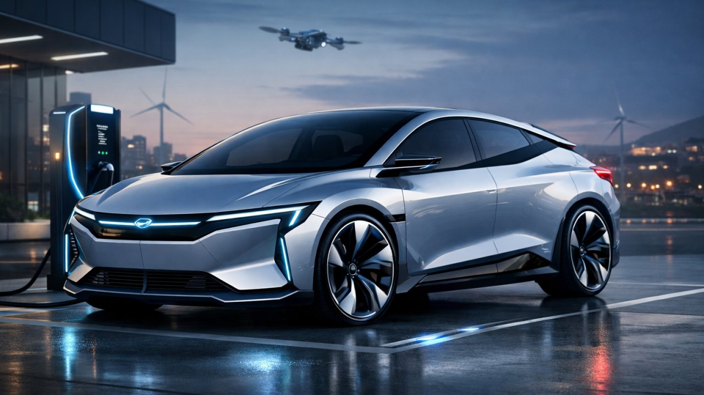

# AI and EVs: Engineering the Future Through Collaboration, Not Competition

*By Simon Nguyen · Originally published on [LinkedIn](https://www.linkedin.com/pulse/ai-evs-engineering-future-through-collaboration-simon-nguyen-o0gnc/)*

## AI-Assisted EV Architecture: Designing Decision-Support Systems for Human Safety and Road Stability

*By Simon Nguyen*

As electric vehicles take on more driving tasks — lane keeping, adaptive cruise, automated parking, and increasingly full route navigation — one principle should guide their design: human safety comes first, and humans stay in the decision seat.

AI is the technology best suited to support that priority: processing far more signals, far faster, than a human driver ever could. But processing more signals is not the same as deserving final authority. This article outlines an AI-assisted EV architecture built around one rule, carried over directly from a companion architecture originally designed for autonomous delivery drones: AI supports, humans decide.

In practice, that means a driver can ask the vehicle to check itself before a trip — any failed components, current battery level, whether the car needs to warm up before driving — on demand, not just as a background process. It also means that while driving, if the battery overheats or runs low, the vehicle informs the driver immediately as a safety condition, not just a range notice.

There's also a cost dimension to this. EV repairs today are expensive, and owners are often steered toward the manufacturer's own service network by default, which keeps costs high. AI-assisted diagnostics can help bring repair costs down through two distinct levers, not one: OEM-approved parts and firmware to prevent counterfeit components from undermining reliability, and accurate AI-generated diagnostics that a licensed independent repair shop can act on directly — creating more work for qualified local shops instead of routing everything back to the manufacturer by default.

## AI as Decision-Support, Not Decision-Maker

The automotive industry already has a live version of this debate, formalized in the SAE driving automation levels. Level 4 and 5 systems aim to give the vehicle full decision authority in defined or all conditions. Level 2 and 3 systems keep a human supervising and ultimately responsible. This architecture is a deliberate case for staying at Level 2/3 by design — not as a limitation of the technology, but as a considered choice about where authority should sit.

This isn't a theoretical caution. Even after years of heavy investment in autonomous driving industry-wide, performance still degrades sharply in snow, ice, and degraded-visibility conditions — the hardest cases remain years away from confident, unsupervised handling. Snow-covered or invisible lane markings and icy road surfaces are exactly the conditions where the AI should be surfacing uncertainty and deferring to the driver, not taking over.

Under this model, the AI continuously evaluates:
●	Drivetrain and battery health
●	Road and traffic risk
●	Environmental conditions
●	System integrity
●	Minimal risk fallback options

The AI surfaces this analysis clearly and in real time. The driver decides when to accept a lane change, when to brake, when to override a suggested maneuver. The AI's job is to make that decision easier, faster, and better-informed — never to make it instead of the driver.

The same advisory role extends to trip convenience, not just safety: the AI can suggest nearby charging stations paired with nearby restaurants or shopping, rather than just the closest plug — another example of AI proposing options and the driver choosing.

## Full-Spectrum Data Capture

An EV is only useful as a decision-support platform when every critical subsystem reports its status continuously, translated into something a driver can act on quickly — not raw sensor values, but clear signals.

●	Drivetrain: motor temperature, inverter health, torque delivery, regenerative braking performance
●	Energy: battery state of charge, cell balancing, pack temperature, internal resistance, predicted range
●	Sensors: camera, radar, lidar, and ultrasonic confidence, calibration drift
●	Environment: road surface condition, weather, visibility, traffic density
●	System Integrity: compute load, watchdog events, sensor disagreement, communication bus health
●	Mission Context: route risk, school zones, construction zones, pedestrian-dense areas, known minimal-risk pull-over points

This data stream is what allows the AI to give a driver a clear recommendation instead of a dashboard full of numbers.

## Redundancy as a Core Safety Principle

The systems that most directly prevent a crash in an EV are braking, steering, and the compute that coordinates them, so that is where redundancy budget belongs.

**Redundant brake-by-wire.** Independent primary and backup braking paths ensure the vehicle can still stop safely if one path degrades or fails. The AI monitors both continuously and flags any divergence between commanded and actual braking response.

**Redundant steer-by-wire.** A backup steering path maintains directional control if the primary path is compromised — applied to the two subsystems that matter most for a vehicle staying on the road.

**Redundant compute.** If the main compute/GPU unit fails, the system delegates down to a co-processor running on a separate power source, handling basic safety functions — stable steering and braking response — rather than losing critical function all at once. This gives the driver a clean, controlled window to take over rather than a sudden loss of assistance.

**Layered safety checks.** The AI evaluates conditions before a drive begins, continuously during the drive, and after the vehicle is parked — three checkpoints where it hands the driver or fleet operator a clear read on vehicle health, not a single opaque judgment.

**Post-accident response.** On a detected collision, once the vehicle is confirmed stationary, doors unlock automatically to allow occupant exit or first-responder access. Seatbelt release is left to the occupant or a first responder rather than automated — an unstable vehicle or a disoriented occupant makes automatic release a real safety risk, not a convenience.

## AI-Assisted Route and Driving Advisories

Route optimization is one of the most valuable things AI brings to this architecture. In a road environment, it needs to be highly reactive, because traffic, pedestrians, and other drivers change conditions second to second, not just route to route.

Given live conditions, the AI can propose routes and advisories that account for school zones, construction zones, pedestrian-dense areas, and current traffic risk — recalculating continuously. The driver reviews and can override any suggestion. This is AI doing what it's genuinely good at — processing many fast-changing variables at once — while leaving the judgment call about acceptable risk with the person actually driving.

Looking ahead, vehicles will increasingly be able to communicate current road conditions with each other and with infrastructure in real time — accidents, congestion, hazards — feeding directly into dynamic routing and improving traffic flow at a system level, not just for a single driver.

## Minimal Risk Condition: A Pre-Defined Fallback, Not an Improvised One

Rather than improvising a response to a critical fault in the moment, automotive safety design already formalizes this: the minimal risk condition, or MRC.

Rather than deciding in the moment, a critical fault — a sensor failure, a system fault the AI cannot resolve, a driver becoming unresponsive during a supervised-automation segment — triggers a pre-defined maneuver: a controlled, gradual stop in-lane, or a controlled pull-over to the shoulder, executed the same way every time. This turns an open-ended “the system will figure out something safe” claim into a concrete, testable one: on a defined fault, the vehicle always executes the same validated maneuver, and the driver or fleet operator is notified immediately.

## AI-Supported Drive Readiness

Before a trip begins — especially relevant for fleet or rideshare EVs — the AI presents a clear readiness assessment covering:

●	Battery state of charge and health
●	Any detected drivetrain or brake system faults
●	Sensor calibration status
●	Route risk given current traffic and weather

The driver or operator reviews this assessment and makes the call — depart, delay, or send the vehicle for service. The AI's role is to make sure no one ever has to guess at a condition it could have measured and reported.

## AI-Based Fault Detection and Predictive Maintenance

After each drive, or continuously for a fleet vehicle, the AI analyzes everything it collected and gives the maintenance team a clear, prioritized readout: what needs attention, on which subsystem, and why. It can detect battery degradation, brake pad wear, motor bearing wear, sensor drift, and thermal patterns well before they become failures.

This doesn't replace a technician's judgment — it gives them a head start, cutting diagnosis time from manual inspection to minutes of AI-prioritized findings that a human then confirms and acts on.

## Cybersecurity and Command Integrity

This matters more for a connected EV than for a delivery drone. Automotive control networks have a well-documented real-world attack surface, and a compromised vehicle is a physical safety hazard, not just a data problem.

●	Secure boot on every control unit, so tampered firmware cannot run.
●	Authenticated, encrypted internal communication, so a spoofed or replayed command on the vehicle's internal network cannot be accepted.
●	Signed over-the-air updates, so only verified software reaches the vehicle.
●	Approved components and firmware, so every MCU and firmware-updated module in the vehicle must be approved by the EV manufacturer before it's accepted. This prevents unqualified counterfeit components from entering the vehicle and undermining reliability — a distinct lever from the labor-cost point made earlier: this is about preventing counterfeit hardware, while keeping repairs affordable is about routing legitimate diagnostic and labor work to licensed independent shops.

This covers the realistic threat surface — tampered software, network-level spoofing, and counterfeit components — without over-building for a threat model, like adversarial jamming, that doesn't fit a consumer or commercial fleet use case.

## Testing and Validation Infrastructure

The automotive industry already has formal rigor here — ISO 26262 for functional safety and SOTIF (safety of the intended functionality) for AI-specific behavior — and this architecture leans on that existing discipline rather than inventing new process.

● **Hardware-in-the-loop (HIL) testing.** Braking, steering, and AI recommendation logic are validated on a HIL rig — real control units, simulated vehicle dynamics — before anything reaches a real vehicle.

● **Fault injection testing.** Sensor dropout, brake-path degradation, and communication loss are deliberately triggered, both on the bench and in controlled test drives, to confirm the AI's recommended response actually works.

● **Regression testing for AI model updates.** When the route-planning or fault-detection model is retrained, it runs against a fixed library of known scenarios before it's pushed to the fleet — a model update that silently regresses on a scenario it used to handle correctly is a safety issue, not just a quality one.

## Hardware Layer Monitoring and Failure Isolation

For an AI-assisted EV fleet to be maintainable at scale, every hardware layer needs continuous monitoring, logged and made visible to the people responsible for it.

● **Comprehensive hardware telemetry —** drivetrain, battery, brakes, steering, sensors, and compute each report detailed status.

● **Layered health tracking —** the AI maintains a running health score for each subsystem, so a technician can see trend, not just current state.

● **Failure isolation —** faults get pinpointed to specific components: cell group 4 imbalance, front-left brake caliper drag, rear radar misalignment.

● **Historical tracking —** every major component carries a digital history of mileage, stress events, temperature exposure, and replacement history.

● **AI-assisted debugging —** the AI identifies the likely failing component and probable cause, and suggests a repair. A technician confirms the diagnosis and verifies the fix.

## Designing for Manufacturing and Maintenance

● **End-of-line calibration and acceptance testing.** Every vehicle coming off the line gets a defined acceptance test — sensor calibration, brake and steering response, battery pack verification — before it ships.

● **Battery and component traceability.** Every pack and major module gets a unique ID at manufacture time, so a defect can be traced back to a manufacturing batch or supplier lot, not just a vehicle's usage history — this is already a major focus in EV recall management industry-wide.

● **Fleet-wide OTA management.** Updates need a defined validation, staged rollout, and rollback path across a fleet that may span multiple hardware and software revisions. A bad update pushed fleet-wide without a rollback plan is one of the more likely ways a well-designed system fails in practice.

● **Predictive spares planning.** The same historical tracking data used for fault detection — mileage, stress events, component age — feeds directly into spares stocking decisions for service centers and fleets.

## V2X and V2I Integration

An EV shares dense, adversarial road space with human drivers and pedestrians, which makes coordination both valuable and hard to get right.

● **Vehicle-to-vehicle (V2V) awareness,** sharing position and intent with nearby connected vehicles where available, combined with the vehicle's own lidar and other sensors, to extend the AI's awareness beyond what any single vehicle can see — a meaningful lever for improving traffic flow and avoiding accidents before they happen.

● **Vehicle-to-infrastructure (V2I) integration,** receiving signal timing, road hazard, and work-zone data directly from infrastructure rather than inferring it purely from cameras.

● **Treating unconnected road users as the default case, not the exception.** Most pedestrians, cyclists, and older vehicles will not be broadcasting anything for years to come — V2X is a valuable supplement to perception, never a replacement for it.

## Human Factors

The entire architecture rests on “the human decides.” That premise only holds if the human stays genuinely engaged.

● **Alert fatigue is a real risk.** If the AI flags routine, low-risk conditions as often as it flags genuine risk, drivers learn to tune it out — and start rubber-stamping recommendations without real scrutiny, which quietly undoes the whole point of keeping a human in the loop. Advisories need to be prioritized, not exhaustive.

● **Driver monitoring, used honestly.** If the system depends on a supervising driver, it needs a genuine way to confirm that supervision is happening — not a checkbox interaction that's easy to defeat.

● **Clear training and expectations.** Drivers and fleet operators need to understand exactly what the AI does and does not take responsibility for, before they rely on it.

## Human Safety → Road and Societal Stability

When AI-assisted vehicles behave predictably and drivers retain clear authority over every decision, the effects compound outward: drivers trust the tools they're using, regulators can evaluate a system with a clear chain of responsibility, insurers can assess risk with confidence, and deployment scales without the trust gap that comes from removing humans from safety-critical decisions.

## AI-Assisted Design Philosophy

A vehicle design under this philosophy is only complete when:

●        All critical signals are captured and translated into clear, actionable information

●        AI proposes routes, flags risk, and recommends actions — but never grants itself authority to override the driver

●        Every safety-critical decision has an accountable human behind it

●        Redundancy exists where it matters most — braking and steering paths

●        A critical fault always triggers the same validated minimal risk condition, not an improvised response

●        Every control unit uses secure boot, authenticated internal communication, and signed OTA updates

●        AI model updates go through the same regression and fault-injection testing as any other safety-critical release

●        Every major component is traceable from manufacture through retirement

●        Manufacturing is scalable and maintenance is modular and AI-guided, not AI-executed

●        Advisories are prioritized, not exhaustive, to protect against alert fatigue

This isn't a limitation on what AI can do — it's a deliberate design choice about where authority should sit. AI makes the drive safer and easier. Humans make the decisions.

## Conclusion

The future of automotive autonomy depends on trust. Trust depends on clear accountability. And accountability depends on keeping humans in the decision seat, supported by AI that does the heavy lifting of data processing, risk surfacing, and route optimization.

This AI-assisted EV architecture offers a path toward vehicles that operate reliably and transparently on real roads — not because the AI is in charge, but because it gives the humans who are in charge everything they need to decide well, quickly, and with confidence.

This is the same design philosophy behind the companion drone architecture, applied to a harder, denser, more adversarial environment: not autonomy that replaces human judgment, but autonomy that sharpens it.
