# Design Thesis: AI-Ready Medical Equipment

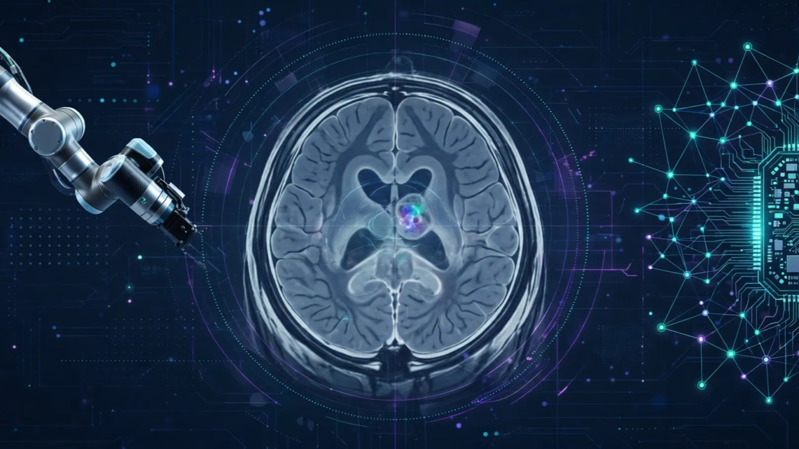

*By Simon Nguyen · Originally published on [LinkedIn](https://www.linkedin.com/pulse/design-thesis-ai-ready-medical-equipment-simon-nguyen-lo6ac/)*

## Simon Nguyen

Systems Architect · Silicon validation, embedded systems and hardware/firmware co-design · 25+ years

### AI-ready medical equipment for surgery and tumor detection

November 2026 · Revision 3

*An idea for discussion. The author is an engineer, not a physician. This is a conceptual architecture, not a product or a cleared medical device, and it has not been clinically validated.*

## Abstract

While contemporary robotics research heavily emphasizes general-purpose humanoid form factors, high-stakes medical and surgical applications demand a different architectural philosophy: mechanical stability, deterministic real-time control, and hardware safety guardrails with a bounded worst-case response time.

This paper outlines the technical blueprint for a specialized, non-humanoid, single-manipulator robot (one arm with an instrument end-effector) on a stabilized mounting framework designed to assist medical professionals during delicate procedures. The architecture combines distributed digital signal processor (DSP) edge nodes, three-phase brushless DC (BLDC) motors under field-oriented control, a learned policy on a dedicated processor with bounded inference time, an independent lockstep safety controller, and dual-domain cross-validation (optical vs. kinetic) fed by a separate safety camera. A surgeon assist mode links magnified viewing to motion scaling so that the platform is useful with the surgeon fully in control, before any autonomy. Doctor-in-the-loop imitation learning connects bare-metal control theory with modern embodied artificial intelligence.

Both the robot and a second application, an MRI tumor-detection unit, are built on one common 4-DSP compute module. Together they illustrate the paper's design thesis: medical equipment should be designed AI-ready from the start, so that AI saves doctors time while doctors stay in control.

## Design Thesis: AI-Ready Medical Equipment

Doctors spend much of their time on work that machines could help with: finding and outlining tumors in scans, measuring them, steadying an instrument during delicate surgery, and writing reports. AI can help, but most medical equipment in use today was designed before modern AI. It was not built to capture the synchronized data that AI learns from, to run AI models safely next to its critical functions, or to update those models in a controlled way.

This paper argues that medical equipment should be designed to support AI from the start, following five principles:

**1.   Capture training data as part of normal work.** Images, motor signals, and sensor readings are recorded with hardware timestamps on a common clock, so the equipment produces data that AI can learn from.

**2.   Keep AI separate from safety.** AI runs on its own processors. Hard safety limits run independently and never depend on the AI being right.

**3.   Update models safely.** Models are retrained offline, validated, signed, and versioned. They never change during clinical use.

**4.   Learn from doctors' corrections.** When a doctor edits an AI result, the correction becomes new training data.

**5.   The doctor makes the final decision.** AI prepares and proposes; a human approves, and every decision is recorded.

**LxM models.** Large language models showed what the transformer architecture can do with text. The same approach works on other signals. This paper calls the family *LxM*, where x is the type of data: kinematic models (LKM) for motion, signal models for sensors, and imaging models for scans. They can be trained large, offline, and then distilled into small versions that run on the equipment with bounded, predictable timing.

**Saving time must be measured.** AI can also add work, for example reviewing false alarms or extra documentation steps. Time per case is therefore a validation metric at every stage, alongside accuracy and safety.

The rest of the paper applies these principles to two applications that share the same compute hardware: a surgical assist robot (Sections 1–4) and an MRI tumor-detection unit (Section 5).

## 1. Architectural Foundation & Control Philosophy

General-purpose humanoid platforms suffer from compounding mechanical tolerances across long kinematic chains (e.g., foot–ankle–hip–torso–shoulder–wrist). In surgical or sub-millimeter tissue manipulation, structural sway and accumulated spatial errors make general humanoid arms poorly suited to the task.

Commercial surgical robots are already non-humanoid, so the non-humanoid form is not itself the contribution of this work. The contribution is the combination of (1) distributed, deterministic edge control at every joint, (2) continuous cross-validation between independent kinetic and optical sensing domains, with diverse (classical vs. learned) vision, and (3) learned manipulation policies with bounded inference time that run above, and never bypass, a hardware safety layer.

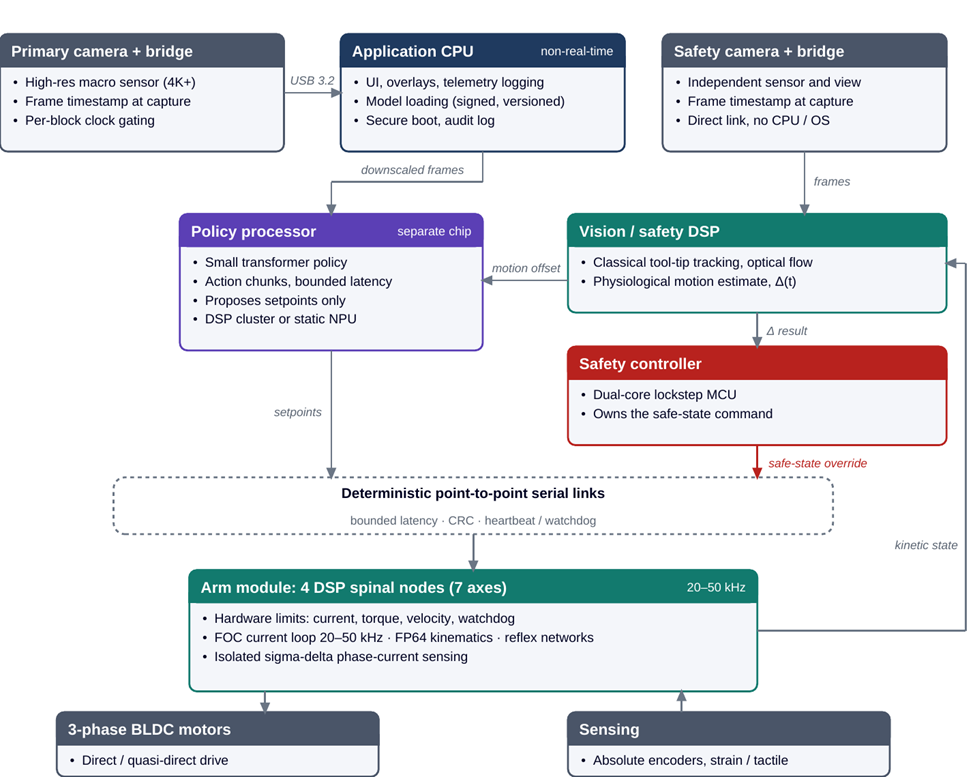

*Figure 1. System architecture: compute partitioning, the two camera paths, deterministic links, joint spinal nodes, actuation and sensing*

### 1.1 Single Manipulator on a Fixed, Rigid Framework

Rather than mounting a manipulator onto an unstable mobile base, the system anchors the end-effector to a rigid, vibration-isolated mechanical gantry referenced to the operating table. This removes base center-of-gravity shifts, isolates the workspace, and reduces structural compliance in the robot itself.

The platform uses one manipulator rather than a multi-fingered hand or a pair of arms. Every added arm or finger adds joints, motors, nodes, and calibration error, and multiplies cost. A single short, stiff kinematic chain keeps the stability advantage that motivates the design and makes the cross-validation in Section 3 tractable.

Full instrument pose needs about six degrees of freedom plus the grip. A natural split is three linear gantry axes for gross positioning and a compact wrist (roll, pitch, yaw) plus grip for fine work. Four DSP spinal nodes drive the seven axes, about two axes per node (Section 2.2).

The trade-off is that many surgical tasks are bimanual: one instrument retracts or holds tissue while the other cuts or sutures, and knot tying needs two instruments. The single-manipulator platform covers this in three ways: (1) a quick-change instrument interface for steps that need different tools in sequence, (2) passive, lockable retractors and tissue holders placed by the clinical team, and (3) collaborative operation in which the surgeon's own hand provides the second instrument. Training (Section 4.3) is therefore focused on steps that one active instrument can complete.

A rigid gantry does not remove patient motion. Respiration, heartbeat, and table adjustments still move the target tissue; this physiological motion is measured and compensated by the optical domain (Sections 2.5 and 3).

### 1.2 Point-to-Point Wiring & Noise Suppression

To ensure deterministic execution and avoid latency jitter on shared, non-deterministic networks (for example, switched Ethernet without time-sensitive networking), all critical control paths use point-to-point serial links with bounded latency. Each link carries CRC-protected frames and a heartbeat/watchdog, so a broken or noisy link drives the node to its safe state.

Classical CAN is priority-arbitrated and gives bounded latency for its highest-priority frames, and deterministic fieldbuses such as EtherCAT are widely used in medical robotics. Point-to-point is chosen here to remove contention entirely and to isolate faults per joint, at the cost of a higher cable count through the joints. EMI robustness comes primarily from differential signaling, shielding, and keeping high-current switching local to each motor (Section 2.2), not from topology alone.

### 1.3 High-Precision Floating-Point Execution (FP64)

Spatial transformations, multi-axis matrix inversions, and continuous integration loops can accumulate numerical error. FP32 provides about seven significant decimal digits, roughly 0.1 µm resolution across a 1 m workspace. That is adequate for a single transform, but it leaves little margin for ill-conditioned inversions near kinematic singularities, chained calibration transforms, and long-running integrators such as velocity-to-position estimates and filter states.

Accumulators are where this failure is real, and it is easy to miss in testing. A simple example: a timer kept as FP32 seconds and advanced by a 20 µs control period (t = t + Δt). Simulated, this timer reads 512 s when the true elapsed time is 457.8 s, a 12% error from rounding, and then stops advancing entirely, because 20 µs is smaller than half the FP32 spacing at 512 s (61 µs). It fails after about 7.6 minutes, while a surgical procedure runs for hours. The same pattern affects trajectory phase, filter states, and multi-turn position counters. A short bench test passes, and the error appears only in long runs.

This class of failure is one the author has fixed in practice. On a laser imagesetter, beam-to-image alignment was being lost because accumulated FP32 truncation had never been identified in the servo control software. The author traced the root cause and resolved it by moving the accumulation to FP64 on a floating-point DSP (software-emulated double precision at the time).

The coordinate-transformation and calibration layer therefore uses 64-bit double precision (FP64), while the inner current loop may remain in FP32 or fixed point. On DSPs with dual (SIMD) floating-point units, FP32 matrix work runs near peak throughput with a deterministic cycle count, but FP64 typically is not full-rate SIMD and costs several cycles per operation. That cost is acceptable at kilohertz kinematic rates, and it is budgeted explicitly per control period rather than assumed. Two practices keep drift bounded regardless of precision: forward kinematics is recomputed every cycle from absolute encoder readings rather than integrated incrementally, and integrator states are periodically re-anchored to absolute measurements.

At the micrometer scale, the dominant positional errors come from mechanical compliance, thermal expansion, and calibration, not floating-point rounding. FP64 removes arithmetic as a contributor so that these physical error sources can be measured and compensated during multi-hour procedures.

### 1.4 Design Heritage: Medical Imaging and Servo Control

The architecture draws on two earlier bodies of work by the author: multi-DSP core systems for MRI medical imaging equipment, his first engineering work, and about two years of servo motor control at Agfa. The MRI work contributes the sensing and processing side:

· **Deterministic pipelines:** fixed-latency processing spread across multiple DSP cores, the same structure the spinal nodes use (Section 2).

· **Synchronized acquisition:** every sample tied to a common clock so that data from different sources can be aligned in time, the requirement behind capture-time frame stamps (Section 2.5) and the multimodal telemetry in Section 4.1.

· **Signal processing on raw sensor data:** filtering and spectral methods applied before any higher-level decision, as in the tremor filtering of Section 4.3.2.

· **Medical-equipment context:** safety expectations set by the IEC 60601 family of standards, of which IEC 80601-2-77 is the robotic-surgery member.

MRI reconstruction is open-loop: a late image delays a diagnosis but harms no one. The servo work at Agfa contributes the closed-loop side. In laser imaging, motor position, velocity, and start/stop behavior must hold the beam locked to the image, so small control errors show up directly as misalignment. The same concerns drive this platform's BLDC actuation, field-oriented control, and hybrid position-to-force switching (Section 2), and that work is where the FP32 accumulation failure in Section 1.3 was found. Here the output moves an instrument in tissue rather than a laser beam, which is why hard node-level limits, watchdogs, an independent safety controller, and defined safe states are added (Sections 2.3 and 3.3).

## 2. Actuation, Edge Nodes & Compute Partitioning

### 2.1 Three-Phase BLDC Actuation

Open-loop stepper motors driven at a fixed current behave as stiff position sources: they push against an obstruction with full holding torque until they stall, and provide no direct torque measurement. That stiffness is a hazard for delicate, deformable biological structures. Closed-loop, current-controlled steppers reduce the problem but still carry lower torque density and higher detent torque than BLDC alternatives.

The end-effector standardizes on three-phase BLDC (permanent-magnet synchronous) motors paired with absolute encoders. These motors offer high torque density, smooth velocity profiles, and torque that is directly observable through phase current. To preserve that torque transparency at the output, the drivetrain uses direct-drive or low-ratio (quasi-direct-drive) transmissions. High-ratio gearing and lead screws add friction and backlash that hide contact forces from the motor current.

### 2.2 Local DSP “Spinal Nodes” and Field-Oriented Control (FOC)

Instead of a single centralized motor controller, four DSP-class controllers act as local “spinal nodes,” each driving about two axes. The node requirements are hardware floating point (32-bit with 64-bit support), at least two integrated three-phase PWM units with dead-time control and hardware fault inputs, enough sigma-delta filter channels for two axes of phase-current sensing, and a deterministic interrupt and DMA structure. One floating-point DSP has ample time for two FOC loops at 20–50 kHz plus the FP64 kinematics; the binding limit is PWM and sensing channels, not compute. Motor-control microcontrollers are an alternative for the current loop.

The four nodes sit together on the arm module, mounted on the gantry carriage. Power stages and gate drivers sit next to each motor and receive PWM over isolated differential lines, so high-current switching stays local to the motor while the control logic stays in one place. Axes are grouped by location and by mechanical coupling:

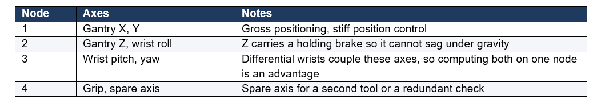

The trade-off is fault isolation per pair of axes rather than per joint: one node failure removes two axes. The safe state accounts for this, with brakes on the gantry axes and a compliant hold on the remaining wrist axes. An alternative is to drive the three gantry axes with commercial servo drives and reserve the four DSP nodes for the wrist and grip, where force sensing and precision matter most.

· **Fast FOC execution:** The local node runs the FOC current loop at 20–50 kHz (20–50 µs per cycle). For a surface permanent-magnet motor, quadrature current is proportional to electromagnetic torque (T = Kt · Iq), so the node observes motor torque every cycle without waiting on the central controller. Cogging, friction, and transmission losses must be modeled to turn this into an estimate of force at the tool tip.

· **Phase-current sensing:** Because Iq is the force estimate, its quality matters. Phase currents are measured with isolated sigma-delta modulators and decimated with SINC filters on the node, rather than with a general-purpose on-chip ADC.

· **Hybrid position-to-force mode switching:** During rapid positioning, the node operates in closed-loop position mode. On detecting contact through phase-current deviation or integrated strain gauges, the node switches to torque-limiting mode within one or two control cycles, capping output force to prevent damage to soft tissue.

· **Reflex networks:** Small neural networks with kilobyte-scale weights run on the node in a fixed time slot separate from the FOC loop: learned friction and cogging compensation (improving the tool-tip force estimate), contact and slip detection (triggering the mode switch), and adaptive tremor filtering of the surgeon's teleoperation input. They fit in on-chip memory and have bounded execution time. Hardware limits still act below them.

· **Debug visibility:** An optional DAC channel exports internal signals (Iq, Δ, filter states) to an oscilloscope in real time during development.

### 2.3 Compute Partitioning

The platform separates compute by timing class and by safety role, so that no learned or non-real-time component shares a processor with the hard real-time or safety functions.

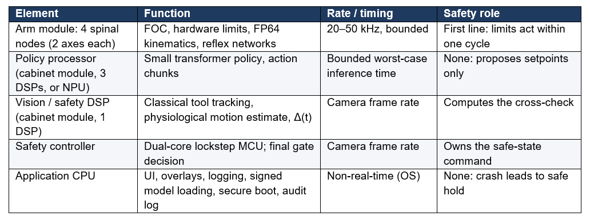

The application CPU runs a general-purpose operating system. It is deliberately kept out of the real-time and safety paths: if it fails, the nodes hold position safely and nothing moves. This separation also keeps most of the software outside the highest software safety class, which reduces verification cost. The safety controller is a separate chip from every other element, because the independence argument in Section 3 requires it. To reduce part count, a DSP device with an integrated application core can serve as both the policy processor and the application CPU; the safety controller stays separate.

### 2.4 Policy Processor: Requirement and Options

The architecture fixes what the policy processor must guarantee, not which chip provides it. The requirement has three parts: a bounded, measurable worst-case inference time; output limited to setpoints; and physical separation from the joint nodes and the safety chain. Because the safety architecture never trusts the policy, the choice of policy hardware does not change the safety case.

Surgical motion is slow, and with action chunking (Section 4.2) the policy predicts the next N setpoints, which the nodes interpolate. A modest inference rate can therefore drive smooth tool motion. Two implementations meet the requirement:

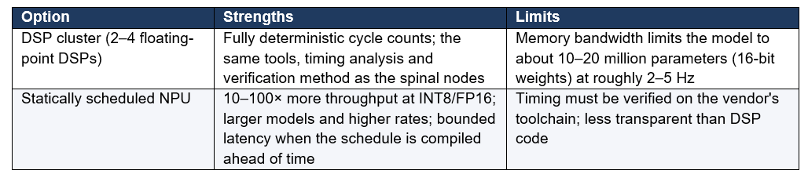

For the DSP option, the binding constraint is memory bandwidth, not arithmetic. At batch size one, a transformer performs about two floating-point operations per weight it loads, so external-memory bandwidth sets the inference rate regardless of the DSPs' dual floating-point units. A policy of 10–20 million parameters is plausible for single, well-defined steps on phantoms (Stages 1–2 of Section 4.3.3). Later stages that need larger models move to the NPU option without any change to the nodes, the safety controller or the cross-validation gate.

Certifying a learned policy depends mainly on validating its behavior, through the staged path in Section 4.3.3, not on its timing. Bounded timing is necessary but not sufficient. Three rules apply to either option:

· **Separate processors.** The policy never runs on the joint nodes, so it cannot add jitter to the 20–50 µs current loop.

· **Physiological motion is handled outside the policy.** Heartbeat motion is around 1–2 Hz, which a slow policy cannot track. The vision / safety DSP estimates tissue motion with classical tracking and adds a real-time offset to the setpoints, so the policy plans in a stabilized tissue frame.

· **Fast events never pass through the policy.** Unexpected contact, slip, and sudden tissue motion are handled by the node limits, the reflex networks, and the cross-validation gate. Policy latency is tolerated because of this layering.

### 2.5 Camera Subsystem

Two cameras serve two different purposes, and their paths are kept independent:

· **Primary camera:** a high-resolution macro sensor behind a camera bridge with a USB 3.2 interface to the application CPU. It feeds the surgeon's display and overlays, telemetry logging, and (after downscaling and cropping on the CPU) the policy processor. Operating-system and USB timing jitter is acceptable on this path because the policy only proposes setpoints and everything is gated below it.

· **Safety camera:** an independent sensor, with its own viewing angle, connected through its own bridge directly to the vision / safety DSP over a parallel or LVDS link. It does not pass through the application CPU or its operating system, so a CPU crash or USB stall cannot blind the cross-check. The second viewpoint also helps when the instrument occludes the target in the primary view.

Both bridges stamp each frame at capture with a hardware timestamp on the system's common clock, carried in the frame header. The vision latency τ in Section 3.3 is computed from these capture stamps, never from host arrival time. Per-block software clock gating in the bridges limits heat near the surgical field.

### 2.6 Surgeon Assist Mode: Magnified View with Motion Scaling

The platform is useful before any autonomy. In assist mode the surgeon controls the instrument through the robot while viewing a magnified image of the site, and the system improves precision without making any decisions. This mode has the simplest regulatory path, and it is where clinical value and training data begin. Magnified visualization already exists in surgical microscopes, exoscopes and robotic consoles; the contribution here is how it is tied to motion control.

· **Zoom-linked motion scaling:** the ratio between the surgeon's hand motion and tool-tip motion follows the zoom level. At 5× magnification, a 5 mm hand movement becomes about 1 mm at the tool tip, so what the surgeon sees and what the tool does stay at the same scale. Scaling and tremor filtering run on the joint nodes, next to the reflex networks (Section 2.2).

· **Low glass-to-glass latency:** the delay from camera capture to the surgeon's display is kept below about 100 ms. Above that, surgeons perceive lag and over-correct. The display path through the application CPU is designed for this (a dedicated display pipeline, not general operating-system scheduling), and latency is measured from the capture timestamps of Section 2.5.

· **Resolution for zoom:** digital zoom crops the image and loses detail. The primary camera therefore uses a high-resolution sensor (4K or more) so that crops stay sharp, or an optical zoom lens where higher magnification is needed.

· **Situational awareness:** at high zoom the surgeon loses sight of the surroundings. A wide-view inset stays on screen, and the system warns when an instrument leaves the magnified frame.

· **Auto-framing:** the tool-tip tracking already used for cross-validation keeps the instrument centered in the zoomed view, so the surgeon does not have to keep adjusting the camera.

All node-level limits and the cross-validation gate stay active in assist mode. The surgeon is in full control, consistent with the principle that AI should assist people, with humans staying in control.

## 3. Dual-Model Real-Time Cross-Validation

To prevent single-point soft failures, vision errors (false detections or “hallucinations”), or encoder slippage, the system continuously cross-checks two independent real-time models. Independence is enforced by separate sensors and separate compute, and by separate power where practical, so that one fault cannot corrupt both domains. The optical domain also uses a different method from the policy: classical tracking on the safety camera rather than learned vision on the primary camera. A hallucination in the learned model cannot fool both.

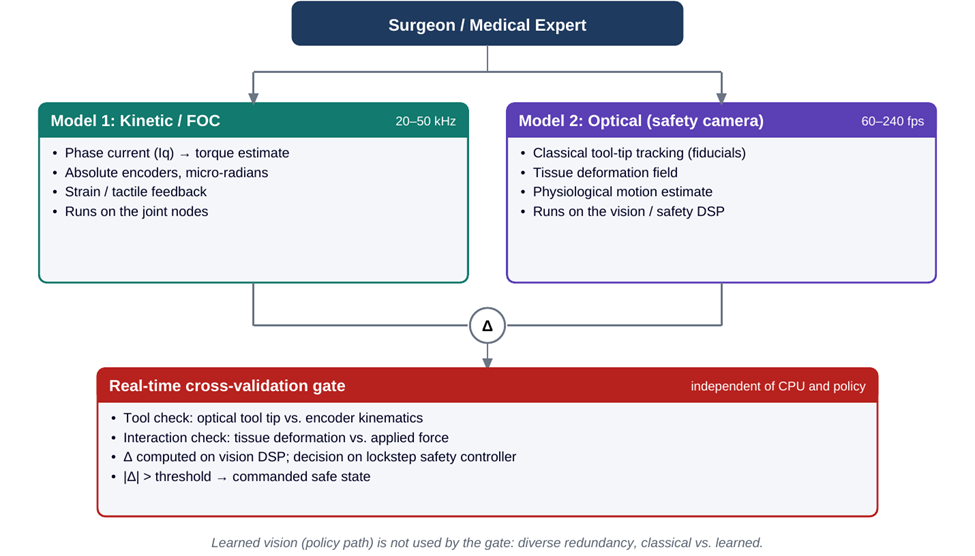

*Figure 2. Dual-domain cross-validation between the kinetic and optical models.*

### 3.1 Model 1: The Kinetic / Proprioceptive Domain

Running directly on the bare-metal joint nodes, Model 1 processes raw hardware metrics: encoder positions, three-phase current vectors, micro-strain values, and temperature. It maintains a real-time estimate of applied effort and mechanical displacement.

### 3.2 Model 2: The Optical / Visual Domain

Using the independent safety camera zoomed onto the target site, Model 2 runs on the vision / safety DSP and performs real-time optical flow, tissue deformation tracking, and feature displacement analysis with classical methods. It tracks the instrument tip (with fiducial markers) separately from the tissue, and it estimates physiological motion so that respiration and heartbeat are not misread as robot-induced motion. The same estimate supplies the motion offset described in Section 2.4.

Camera frame rates (typically 60–240 fps) plus processing latency make this domain two to three orders of magnitude slower than Model 1. The cross-validation design accounts for that difference explicitly.

### 3.3 Layered Safety Interlocks

The system compares the two domains in a common, calibrated coordinate frame:

Δ(t) = ‖ Xkin(t) − Tcam→base · Xopt(t − τ) ‖

where Tcam→base is the hand–eye calibration transform and τ is the vision latency, measured per frame from the capture timestamp. Two checks run in parallel:

· **Tool check:** kinematic tool-tip position vs. optically tracked tool-tip position. A large Δ indicates slippage, mechanical disengagement, an encoder fault, or loss of calibration.

· **Interaction check:** tissue deformation observed optically vs. force measured kinetically, after subtracting estimated physiological motion. Deformation without matching force, or force without matching deformation, indicates unexpected contact or a vision fault.

Thresholds are set from the measured noise and latency of each domain so that false alarms stay rare. Frequent false stops would push clinicians to disable the check, which defeats its purpose.

Enforcement is layered by speed. Hardware limits on each node (current, torque, velocity, watchdog) act within one control cycle and do not depend on software. The cross-domain comparison runs at the vision frame rate: the vision / safety DSP computes Δ, and the dual-core lockstep safety controller makes the decision and commands the nodes into their safe state, overriding the policy and the application CPU.

The safe state is defined per procedure step. With an instrument engaged in tissue, a compliant position hold is generally safer than a rigid freeze or a power-off. These mechanisms map to the protective-stop concept in IEC 80601-2-77, the particular standard for robotically assisted surgical equipment.

## 4. Machine Learning & Structural Extension

### 4.1 Doctor-in-the-Loop Imitation Learning

Rather than deploying fully autonomous algorithms directly into clinical environments, the system uses a collaborative training process:

**1.   Demonstration phase:** A specialist operates the end-effector through teleoperation or micro-haptic controls while viewing zoomed optical feeds.

**2.   Synchronized multimodal telemetry:** The application CPU logs time-aligned data pairs, with hardware timestamps on a common clock: high-resolution camera frames paired with low-level node current/torque vectors.

**3.   Policy training:** A transformer-based policy learns the implicit “grammar” of tissue manipulation, mapping optical and force input to smooth kinematic and force trajectories.

Comparable approaches have been demonstrated. Action Chunking with Transformers (ACT) learned fine bimanual manipulation from about ten minutes of demonstrations, and SRT-H (Johns Hopkins / Stanford, 2025) completed the clipping-and-cutting phase of ex vivo cholecystectomy using a hierarchical transformer policy. Those systems used larger models on GPUs; this platform targets a smaller policy sized for bounded inference on a dedicated policy processor (Section 2.4).

Training happens offline. Models are frozen, signed, versioned, and validated before clinical use, and the application CPU checks the signature before loading weights onto the policy processor. The learned policy runs in the supervisory layer and outputs setpoints only; it never bypasses the node-level limits or the cross-validation gate.

### 4.2 Expanding the Transformer Paradigm Beyond Text

While Large Language Models (LLMs) were popularized through natural language processing, the underlying self-attention architecture is a general sequence model that also works on continuous, multimodal time series. In this platform the idea extends to the LxM family introduced in the design thesis, here Large Kinematic Models (LKMs) and Large Signal Models, closely related to the vision-language-action models in current robotics research. They are trained large offline and distilled into the small, bounded policy of Section 2.4:

· **Tokens as vectors:** Instead of text tokens, input streams consist of synchronized multi-channel vectors containing pixel embeddings, motor phase currents, joint angles, and tactile pressure fields.

· **Predictive control:** The model predicts an N-step future kinematic state (an “action chunk”) at a few hertz, so the system can anticipate tissue compliance and adjust servo setpoints before stress peaks. The nodes interpolate between predicted setpoints, the physiological motion offset is added outside the model, and the FOC loops track the result; the transformer is not inside the hard real-time loop.

### 4.3 Mirror-Model Visual Imitation Training

Recording only video of a doctor operating by hand leaves out the actions (force, grip, and exact tool pose), so it cannot directly train a motion policy. The mirror-model method avoids that gap by teaching the machine the *result* each step must produce, and letting the machine work out its own actions using its encoders and current sensing.

Two matched training models (phantoms, and later ex vivo tissue) are set up side by side. The doctor operates on Model A by hand, using one active instrument to match the machine, under a high-resolution, zoomed camera with AI assistance. The machine operates on Model B. An AI comparator scores how closely the machine's result matches the doctor's, step by step.

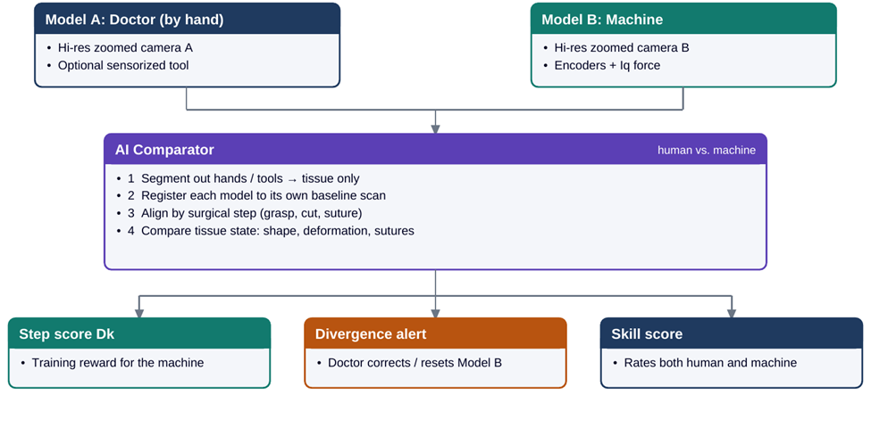

*Figure 3. Mirror-model training: the AI comparator scores the machine's result against the doctor's.*

### 4.3.1 AI Comparator

Raw pixels differ between the two scenes for reasons that have nothing to do with surgical quality: lighting, camera angle, and human hands versus robot tools. The comparator therefore evaluates tissue state, not images:

**1.   Segment:** remove hands and instruments from both views so only tissue remains.

**2.   Register:** scan both models before the procedure and measure each one relative to its own starting state, since two phantoms are never perfectly identical.

**3.   Align by step:** the doctor and the machine work at different speeds, so the procedure is divided into surgical steps (grasp, retract, cut, place suture) and compared at the end of each step, not frame by frame.

**4.   Measure:** compare a tissue-state descriptor S, made of 3D surface shape, deformation field, cut edges, and suture positions and spacing.

Dk = d( SA,k − SA,0 , SB,k − SB,0 )

Here k is the surgical step, subscript 0 is the baseline scan, and d is a learned or geometric distance. If Dk exceeds a threshold, the doctor corrects or resets Model B before the next step, so that small early errors do not compound and make later steps meaningless to compare. The comparator runs offline on training infrastructure, not on the robot's safety or policy hardware.

### 4.3.2 Human vs. Machine Stability

A human hand is not perfectly stable. Physiological tremor (roughly 8–12 Hz) is always present, and its effect at the instrument tip grows with fatigue and with less experience. A machine on a rigid frame does not tremble, so the system must not treat the doctor's demonstration as an exact path to copy. Four rules follow:

· **Compare outcomes, not paths.** The comparator scores the tissue result of each step. A machine that reaches the same result more smoothly is not penalized for differing from a shaky path.

· **Filter the demonstrations.** Where the doctor's motion is tracked, the tremor band is filtered out before it is used as a reference, the same tremor filtering that microsurgery robots already apply to the surgeon's input (and that the reflex networks of Section 2.2 apply in teleoperation).

· **Weight teachers by skill.** The comparator scores the human as well as the machine. Demonstrations from experienced surgeons, and steps with better outcomes, carry more weight in training.

· **Keep judgment human.** The machine can exceed its teachers in steadiness, but deciding what to do, and when to stop, stays with the surgeon.

### 4.3.3 Filling the Force Gap and the Path to Autonomy

Images show the result, not how hard the doctor pressed. Force is added in two ways: a sensorized instrument (strain gauge in the handle) during mirror sessions, and teleoperated sessions in which the doctor operates through the machine so force is captured directly. Mirror mode, teleoperation, and shadow mode share the same camera, AI, and comparison pipeline. Together they form a staged path to autonomy:

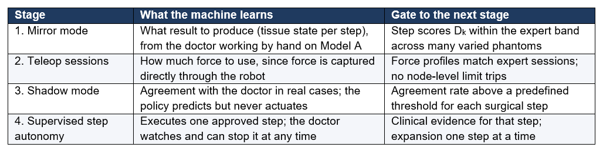

Training happens offline at every stage, and each model is validated and versioned before use, consistent with Section 4.1.

### 4.4 Bidirectional Training: The Machine Trains New Doctors

The training loop runs in both directions. Experienced surgeons teach the machine (Section 4.3), and the trained system then helps teach new surgeons. The same camera, comparator, and phantom setup serve both purposes, so no new hardware is needed.

· **Reversed mirror mode:** the machine performs a validated step on Model A as a repeatable demonstration, and the trainee performs it on Model B. Unlike a human instructor, the demonstration is identical every time and can be slowed down or paused at any point.

· **Objective scoring:** the comparator already scores human work (Section 4.3.2). For a trainee it reports the step score Dk, tremor amplitude, path smoothness, force applied (in teleoperated sessions), and time per step, tracked across sessions to show progress.

· **Live guidance:** the zoomed display can overlay the expert target tissue state for the current step. In teleoperated sessions the machine can also enforce soft force limits and virtual boundaries, so the trainee learns where the safe limits are without damaging the model.

· **Data flywheel:** trainee sessions add data. Trainees who reach expert-level scores become new teachers for the machine, widening the pool of demonstrations.

Three limits apply. First, the reference for scoring must be outcomes validated by expert surgeons, not the machine's own habits; otherwise the machine teaches its own biases. Second, the system grades technical skill only, so clinical judgment, decision-making, and certification stay with human educators and boards. Third, trainees must also practice without guidance so that they do not come to rely on the overlay.

Training on phantoms involves no patient, so this application generally faces a lighter regulatory path than clinical autonomy. It can therefore reach use earlier, and it generates the expert-validated data that the clinical stages in Section 4.3.3 depend on.

## 5. Common Compute Platform: Surgical Robot and Tumor-Detection Unit

The same compute hardware supports two separate products. The shared element is a 4-DSP compute module: four floating-point DSPs with local memory, deterministic DSP-to-DSP links on a common clock, and secure boot. The module carries no motor or imaging hardware; application-specific carrier boards supply that. Drivers, the real-time operating system, secure boot and the validation framework are shared across both products.

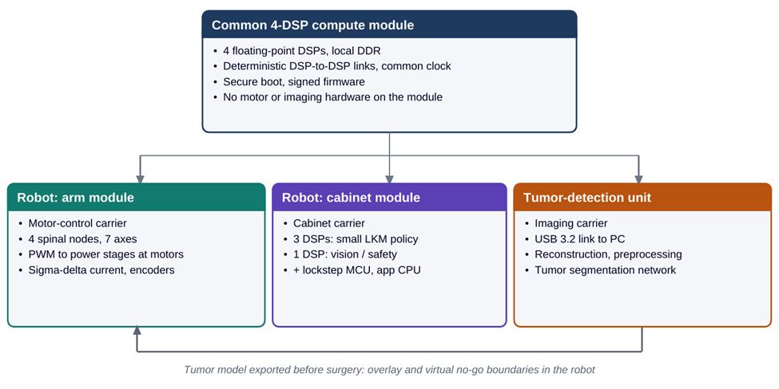

*Figure 4. One compute module, three uses: the robot's arm and cabinet modules, and a stand-alone tumor-detection unit.*

### 5.1 In the Surgical Robot

The robot uses two modules. The arm module, on a motor-control carrier, provides the four spinal nodes of Section 2.2. The cabinet module provides the policy processor (three DSPs running the small LKM of Section 2.4) and the vision / safety DSP. The lockstep safety controller and the application CPU sit on the cabinet carrier, separate from the module, as Section 2.3 requires.

### 5.2 In the Tumor-Detection Unit

Without motor control, one module on an imaging carrier connects to a PC through a USB 3.2 device interface. The link is ample for the task: a multi-sequence MRI study of a few hundred megabytes transfers in about a second at USB 3.2 Gen 1 rates (roughly 400 MB/s in practice), and even raw multi-coil k-space data takes only seconds.

· **The PC** provides the user interface, display, and DICOM/PACS connection. It is non-real-time and stays outside the validated processing path, the same rule the robot applies to its application CPU.

· **The module** runs the validated processing pipeline: reconstruction and preprocessing (FFTs, filtering, bias-field correction, registration), which is classic multi-DSP work, and a tumor segmentation network.

· **Speed:** a 3D segmentation network over a full MRI volume is on the order of 1 TFLOP of work. At the roughly 10–20 GFLOPS that four DSPs sustain, this takes several minutes per study, acceptable because detection is not a real-time task. A GPU workstation is faster; the module's advantages are a deterministic, verifiable pipeline, low cost, and the ability to be embedded inside imaging equipment.

· **Data protection:** studies are patient health information, so the link is authenticated and encrypted, and the module accepts only signed firmware and signed model weights.

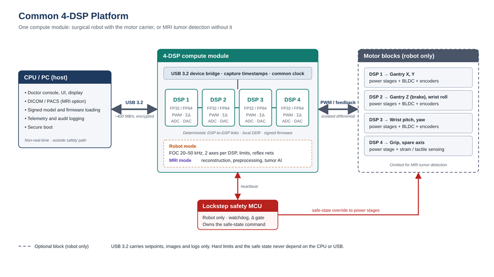

*Figure 5. Common 4-DSP platform: the host CPU or PC connects over USB 3.2; motor blocks and the lockstep safety MCU are present only in the robot.*

### 5.3 Doctor-in-the-Loop Training for Tumor Detection

The tumor-detection model is trained with doctors in the same way the robot is (Section 4). It becomes an automation tool for the routine work of finding, outlining, and measuring tumors, while the doctor always makes the final decision. Each stage measures the doctor's time per case as well as accuracy, since saving time is the goal.

· **Expert labels:** radiologists outline tumors on past studies to create the first training set. Where available, labels are confirmed by pathology (biopsy results), which is the true reference, rather than by a single reader's opinion.

· **Learning from corrections:** in use, every edit a doctor makes to an AI outline (adding a missed region, removing a false one, adjusting a boundary) is logged as a new labeled example.

· **Offline retraining only:** the model never changes while in clinical use. Corrections are collected, the model is retrained offline, validated against a fixed test set, signed, and released as a new version, consistent with Section 4.1. Planned updates of this kind can be described in advance to the regulator through a predetermined change control plan.

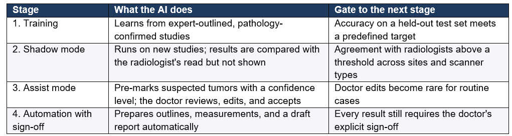

The final decision always stays with the doctor. The system cannot finalize a finding without an explicit sign-off, and an audit log records who accepted, edited, or rejected each AI result and which model version produced it. Two risks are designed against. First, *automation bias*: doctors may over-trust a usually-correct tool, so the display shows confidence levels and highlights uncertain regions, and a sample of cases is read without the AI for quality monitoring. Second, *label drift*: if one doctor's habits dominate the corrections, the model learns them, so corrections from several readers are combined, and disagreements go to consensus or pathology.

### 5.4 From Diagnosis to Surgery

MRI shows tumors at about millimeter resolution, not individual cancer cells. The two products therefore divide the work. Before surgery, the tumor-detection unit segments the tumor, the doctor reviews and approves the outline, and only the approved tumor model is exported. The robot registers that model to the patient with fiducials, overlays the tumor outline on the surgeon's magnified view, and enforces virtual no-go boundaries around vessels and nerves through its safety layer. During surgery, a fluorescence or near-infrared mode on the primary camera (for example with 5-ALA or ICG agents) shows tumor margins at much finer scale. The robot itself stays outside the MRI scanner: its BLDC motors contain magnets and are not MRI-compatible.

Shared hardware does not mean a shared regulatory submission. Tumor detection is a diagnostic function and the robot is a surgical device; each needs its own clearance, with separate software builds, validation, and labeling.

## 6. Conclusion

By moving away from general-purpose humanoid robotics and anchoring development on a stabilized, fixed framework, engineering focus returns to precision and safety. The platform combines DSP spinal nodes with FP64 kinematics, BLDC field-oriented control and on-node reflex networks; a learned policy with bounded inference time on its own processor; a surgeon assist mode with zoom-linked motion scaling; an independent safety camera, classical vision and a lockstep safety controller for dual-domain cross-validation; a non-real-time application CPU kept out of the safety path; a common 4-DSP compute module shared with a tumor-detection unit; and mirror-model imitation training with an AI human-vs-machine comparator that also trains new surgeons. Together these establish a deterministic, fault-tolerant platform designed for high-precision medical applications, and an example of the paper's thesis: medical equipment designed AI-ready from the start, so that AI saves doctors time while doctors stay in control.

## References

[1] Zhao, T. Z., Kumar, V., Levine, S., Finn, C. “Learning Fine-Grained Bimanual Manipulation with Low-Cost Hardware” (ACT / ALOHA). Robotics: Science and Systems XIX, 2023. arXiv:2304.13705.

[2] Kim, J. W., et al. “SRT-H: A hierarchical framework for autonomous surgery via language-conditioned imitation learning.” Science Robotics 10(104), 2025. doi:10.1126/scirobotics.adt5254.

[3] IEC 80601-2-77:2019 + AMD1:2023. Medical electrical equipment — Part 2-77: Particular requirements for the basic safety and essential performance of robotically assisted surgical equipment.
