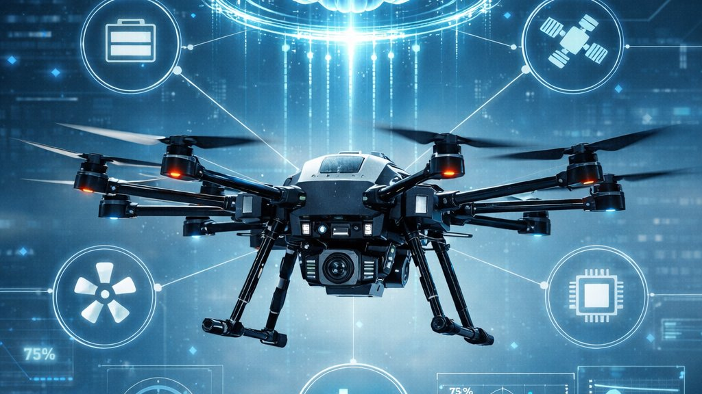

# AI Supervised Drone Architecture: Building Autonomous Systems That Protect People

*By Simon Nguyen · Originally published on [LinkedIn](https://www.linkedin.com/pulse/ai-supervised-drone-architecture-building-autonomous-systems-nguyen-ormcc/)*

## AI-Assisted Drone Architecture: Designing Decision-Support Systems for Human Safety and Societal Stability

*By Simon Nguyen*

As drones move into everyday life — delivering goods, inspecting infrastructure, supporting emergency services — one principle must guide their design: **human safety comes first.**

The technology best suited to support that priority is AI — not as the final authority, but as an advisor that gives delivery teams and operators the clearest possible picture, faster than any human could assemble alone. AI doesn't replace human judgment here; it removes the blind spots that make human judgment harder than it needs to be. This article outlines a complete AI-assisted drone architecture built around one rule: **AI supports, humans decide.**

### AI as Decision-Support, Not Decision-Maker

Traditional drones rely on fixed rules and manual oversight, which leaves operators making high-stakes calls with incomplete information. AI-assisted drones close that gap by continuously evaluating:

Mission safetyRoute risk, including proximity to residential areas, schools, and hospitalsEnvironmental conditionsSystem healthEmergency landing options

The AI surfaces this analysis clearly and in real time. But the operator decides whether to fly, where to fly, and when to abort. The AI's job is to make that decision easier, faster, and better-informed — not to make it instead of the human.

### Full-Spectrum Data Capture

A drone is only useful as a decision-support system when every critical subsystem reports its status continuously, and that data is translated into something an operator can act on quickly — not raw numbers, but clear signals.

**Propulsion** — motor RPM, ESC current, vibration signatures, temperature, thrust imbalance

**Energy** — dual battery voltages, internal resistance, temperature, switching events, predicted remaining flight time

**Sensors** — GNSS quality, IMU drift, barometer stability, lidar/vision reliability

**Environment** — wind load, temperature, turbulence, obstacle proximity

**System Integrity** — CPU load, watchdog events, sensor disagreement, communication link quality

**Mission Context** — corridor safety, emergency landing zones, weather changes, residential and sensitive-area proximity

This data stream is what allows the AI to give an operator a clear recommendation instead of a wall of telemetry.

For a commercial delivery fleet, dedicated anti-jam hardware is unnecessary — this isn't a contested-airspace use case. The more realistic risk is unintentional GNSS interference in dense urban environments, which the AI can catch cheaply by cross-checking reported GNSS position against IMU dead-reckoning: any disagreement between the two is flagged as a fault condition, the same way any other sensor disagreement is. Combined with secure boot on every unit — which the platform already requires — this covers the realistic threat surface without over-engineering for a threat model that doesn't fit the use case.

### Redundancy as a Core Safety Principle

AI-assisted drones still need layered redundancy — the AI doesn't replace safe hardware design, it makes safe hardware design more effective by watching it closely.

**Dual battery systems.** Two independent power sources keep the drone flying even if one pack degrades or fails. The AI monitors both packs continuously and gives the operator an accurate, live estimate of remaining flight time.

**Eight-motor propulsion (octocopter design).** An eight-motor configuration builds in propulsion redundancy. Delivery altitudes are typically too low for a parachute to fully deploy and stabilize, so motor redundancy — not a parachute — is the primary mitigation for a mid-flight failure. If one or even two motors fail, the AI immediately notifies the delivery team and diverts to the nearest pre-approved emergency landing zone, while the operator retains override authority over what happens next.

**A pre-mapped emergency landing zone network.** Rather than deciding a landing spot in the moment, every route is planned against a network of pre-approved landing platforms and zones — rooftops, cleared lots, designated pads — established in advance, not on the fly. The AI's job during a motor-out event is simple and testable: identify the nearest pre-approved zone, divert there, and immediately flag the location to the delivery team for physical recovery. This turns an open-ended "AI figures out somewhere safe" claim into a concrete, certifiable one — the drone is always within a defined distance of an approved landing zone throughout its route.

**Layered safety checks.** The AI evaluates conditions before takeoff, during flight, and after landing — three checkpoints where it hands the operator a clear read on risk, rather than a single opaque judgment.

### AI-Assisted Route Planning

One of the most valuable things AI brings to this architecture is fast, multi-variable route optimization. Given live conditions, the AI can propose a flight path that avoids residential neighborhoods, schools, hospitals, and other sensitive areas, while weighting for proximity to the pre-approved emergency landing zone network — recalculating in seconds as conditions change.

The operator reviews the proposed route, adjusts it if needed, and approves it. This is AI doing what it's genuinely good at — processing many variables at once — while leaving the judgment call about acceptable risk where it belongs: with the person accountable for the mission.

### Airspace Integration

Avoiding people on the ground is only part of operating safely — a delivery drone also shares airspace with other aircraft, and increasingly with other drones. Three things need to be built in from the start, not added later:

**Remote ID broadcast.** Every drone continuously broadcasts its identity and location, a requirement that's already moving from best practice to legal mandate in most jurisdictions. This isn't optional infrastructure — it's the baseline for being allowed to fly commercially at all.

**Deconfliction with other traffic.** As drone delivery scales, drones need to coordinate with each other and with manned aircraft in shared airspace — typically through integration with a UTM (unmanned traffic management) system rather than each drone making independent, uncoordinated decisions. The AI's route planning should treat other known traffic as a live input, the same way it already treats weather and residential proximity.

**Geofencing against restricted airspace.** No-fly zones — airports, government buildings, temporary flight restrictions — are a harder constraint than "avoid this neighborhood if possible." These need to be treated as absolute boundaries the AI's route planning cannot propose crossing, not soft preferences it optimizes around.

### AI-Supported Mission Readiness

Before takeoff, the AI presents a clear readiness assessment covering:

Route risk, including residential and sensitive-area exposureBattery marginsWeather conditionsAny detected faults, however minor

The operator reviews this assessment and makes the call — fly, delay, or stand down. The AI's role is to make sure no operator ever has to guess at conditions it could have measured and reported. Mission approval stays a human responsibility, informed by the best data available.

### AI-Based Fault Detection and Predictive Maintenance

After each flight, the AI analyzes everything it collected and gives the maintenance team a clear, prioritized readout: what needs attention, on which subsystem, and why. It can detect battery degradation, motor bearing wear, ESC over-current events, sensor drift, overheating patterns, and communication instability well before they become failures.

This doesn't replace the technician's judgment — it gives them a head start, cutting diagnosis time from hours of manual log review to minutes of AI-prioritized findings that a human then confirms and acts on.

### Hardware Layer Monitoring and Failure Isolation

For an AI-assisted drone fleet to be maintainable at scale, every hardware layer needs continuous monitoring, logged and made visible to the people responsible for it.

**Comprehensive hardware telemetry** — power, propulsion, sensors, compute, and communication subsystems each report detailed status.

**Layered health tracking** — the AI maintains a running health score for each hardware layer, so a technician can see trend, not just current state.

**Failure isolation** — faults get pinpointed to specific components: motor #6 bearing wear, ESC #3 over-current, battery pack B resistance rising, IMU drift, GNSS multipath, compute thermal throttling.

**Historical tracking** — every component carries a digital history of flight hours, stress events, temperature exposure, and replacement history.

**AI-assisted debugging** — the AI identifies the likely failing component and probable cause, and suggests a repair. A technician confirms the diagnosis and verifies the fix.

**A shared diagnostic bus.** Component-level fault isolation only works at scale if every subsystem speaks the same language. Propulsion, power, sensors, and compute should report over a common bus (e.g., CAN) with a defined message schema per subsystem — otherwise the "unified health score" the AI produces is only as good as a brittle, hand-built integration layer behind it.

**Black-box flight recording.** Summarized health scores are enough for routine maintenance, but intermittent faults — the hardest kind to chase — need raw, high-rate telemetry buffered around the moment of the fault. A flight-recorder-style buffer that preserves the seconds before and after an anomaly turns "it happened once and we don't know why" into a reproducible case.

**Simulation and replay.** Recorded fault scenarios should be replayable on the bench, fed back into the AI model to confirm it reproduces the same fault detection and recommendation — so a fix can be validated offline before anyone trusts it in the field again.

### Testing and Validation Infrastructure

Debugging tells you what went wrong after the fact. Testing is what keeps the AI's recommendations trustworthy before anything reaches an operator or the field.

**Hardware-in-the-loop (HIL) testing.** Motor mixing logic, failure-response behavior, and the AI's route and fault recommendations all need validation on a HIL rig — real flight controller and sensors, simulated flight dynamics — before any of it flies on a real airframe.

**Fault injection testing.** Motor-out, sensor dropout, GNSS loss, and comms degradation should be deliberately triggered, both on the bench and in controlled flight, to confirm the AI's recommended response actually works in practice — not just that it's logically sound on paper.

**Regression testing for AI model updates.** When the route-planning or fault-detection model is retrained or updated, it needs to run against a fixed library of known scenarios before it's pushed to the fleet, the same way firmware or software would go through CI before release. A model update that silently regresses on a scenario it used to handle correctly is a safety issue, not just a quality one — this deserves the same rigor as any other safety-critical release process.

### Designing for Manufacturing and Maintenance

An architecture only succeeds if it can be built efficiently and serviced reliably by the people on the ground.

**Modular construction** — replaceable motor pods, ESC blocks, sensor clusters, battery trays, and landing gear assemblies**Standardized components** — common fasteners, connectors, and wiring harnesses to reduce cost and simplify service**Accessible layout** — batteries, ESCs, motors, and sensors positioned for easy reach**AI-guided maintenance workflow** — guided repair steps, QR-coded modules, diagnostic ports, and firmware-linked component history, all designed to make the technician's job faster without taking the decision out of their hands**Manufacturing scalability** — automated assembly, predictable tolerances, and simplified quality control

**End-of-line calibration and acceptance testing.** Every unit coming off the line needs a defined acceptance test — motor balance, sensor calibration, communication check — before it ships. This is the manufacturing-time counterpart to the pre-flight verification delivery teams run before every mission, just applied once at first build.

**Serialization and traceability.** Every module — motor pod, ESC block, battery tray, sensor cluster — gets a unique ID at manufacture time, not just at install. That way a defect can be traced back to a manufacturing batch or supplier lot, not just a flight history, which matters enormously once a fleet scales past a handful of units.

**Fleet-wide firmware and software management.** Updates need a defined validation, staged rollout, and rollback path across a fleet that may span multiple hardware revisions. A bad update pushed fleet-wide without a rollback plan is one of the more likely ways a well-designed system fails in practice — this deserves explicit ownership, not an assumption that updates "just work."

**Predictive spares planning.** The same historical tracking data used for fault detection — flight hours, stress events, component age — should feed directly into spares stocking decisions, so maintenance teams aren't caught without the part a predictable failure is about to require.

### Operational Pre-Flight Verification for Delivery Teams

The AI advisor doesn't remove the delivery team's role — it sharpens it. Before a drone begins autonomous flight, the team still runs a short, structured pre-flight check.

**A short on-site flight check (2–3 minutes)** puts the drone through a low-altitude hover, gentle lateral movement, slow rotation, brief climb and descent, and communication link validation. The command link itself is encrypted and authenticated, so a spoofed or replayed command can't be accepted mid-flight — a lightweight complement to the secure-boot protection already built into every unit.

**AI real-time assessment** during that check covers motor balance, ESC current, IMU drift, barometer stability, camera/lidar confidence, wind load, and communication latency — surfaced to the operator in plain terms.

**Operator visual confirmation** covers the basics a human eye is still best at: no physical damage, no loose connectors, no cracked propellers, batteries fully seated, sensors unobstructed.

**Mission unlock is an operator decision**, informed by the verification flight and the AI's assessment. The AI doesn't grant permission — it gives the operator what they need to grant it themselves, confidently.

### Human Safety → Societal Stability

When delivery teams have better information and retain clear authority over every mission, the effects compound outward: operators trust the tools they're using, communities see a human accountable for every flight, regulators can evaluate a system with a clear chain of responsibility, and deployment scales without the trust gap that comes from removing humans from safety-critical decisions.

### AI-Assisted Design Philosophy

A drone design under this philosophy is only complete when:

All critical signals are captured and translated into clear, actionable informationAI proposes routes, flags risk, and recommends actions — but never grants itself authority to flyEvery mission-critical decision has a named, accountable human behind itRedundancies exist at every layer — eight-motor propulsion, dual batteriesEvery route stays within a defined distance of a pre-approved emergency landing zoneEvery drone broadcasts Remote ID, deconflicts through UTM, and treats restricted airspace as an absolute boundaryHardware layers are monitored and failures are isolated quickly, with a human confirming every diagnosisEvery subsystem reports over a shared diagnostic protocol, with black-box recording and offline replay for intermittent faultsAI model updates go through the same regression and fault-injection testing as any other safety-critical releaseEvery module is serialized and traceable from manufacture through retirementManufacturing is scalable and maintenance is modular and AI-guided, not AI-executedDelivery teams perform pre-flight verification and retain final mission-unlock authority

This isn't a limitation on what AI can do — it's a deliberate design choice about where authority should sit. AI makes the job easier. Humans make the decisions.

### Conclusion

The future of autonomy depends on trust. Trust depends on clear accountability. And accountability depends on keeping humans in the decision seat, supported by AI that does the heavy lifting of data processing, risk surfacing, and route optimization.

This AI-assisted drone architecture offers a path toward drones that operate reliably and transparently in human environments — not because the AI is in charge, but because it gives the humans who are in charge everything they need to decide well, quickly, and with confidence.

This is the next generation of autonomous systems: not autonomy that replaces human judgment, but autonomy that sharpens it.
