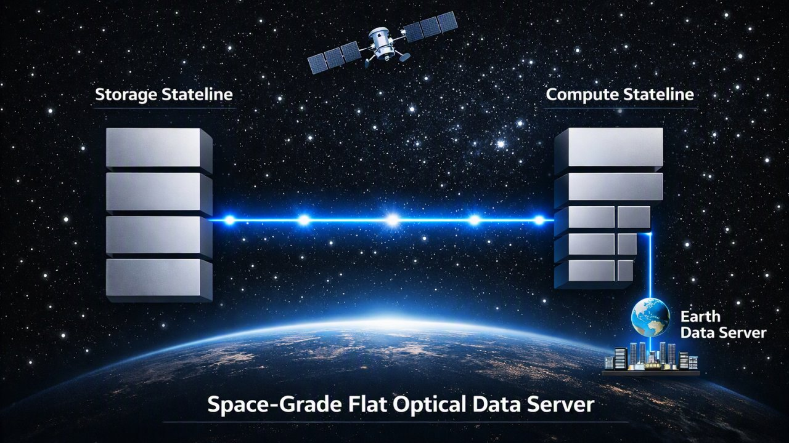
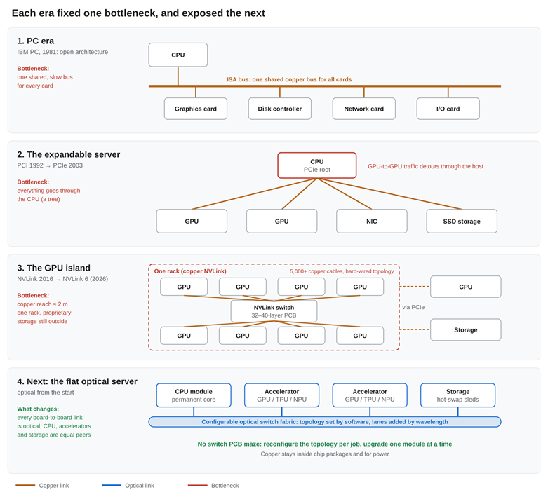
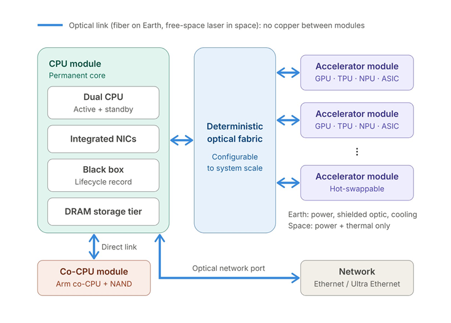
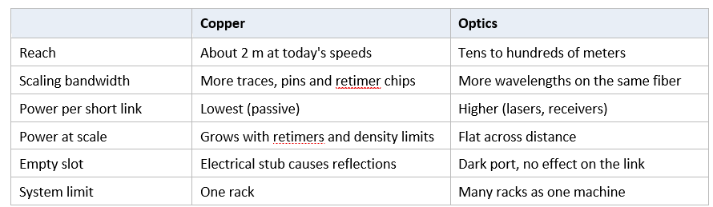
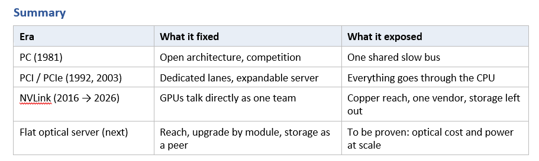

# Breaking the Infrastructure Wall: From the PC to an Open, Optical AI Server

*By Simon Nguyen · Originally published on [LinkedIn](https://www.linkedin.com/pulse/breaking-infrastructure-wall-modular-opticalfirst-server-simon-nguyen-somzc/)*

Simon Nguyen · about a 10-minute read

The AI build-out is running into a hard physical and financial wall. Inside a modern AI data center you see a costly cycle: large, monolithic servers that are expensive to build, consume enormous power, lock operators into one vendor, and become outdated the moment the next accelerator generation ships.

This is not the first time computing has hit a wall like this. Every few decades, the way we connect the parts of a computer runs out of room, and the industry breaks through with a new interconnect. Each breakthrough fixes one bottleneck and exposes the next. If you follow that history, the next step stops looking like a fancy design and starts looking inevitable.

**Part 1** walks through that history in four steps. **Part 2** describes the server I believe comes next: open, modular, and optical from the start.

### Part 1: How we got here

*Figure 1. Four eras of the server. Each fixed one bottleneck and exposed the next*

### 1. The PC era: open architecture wins

In 1981, IBM released the PC with a published, open architecture. Any company could build a compatible card for its expansion bus, and soon any company could build a compatible PC. That openness turned a niche product into a global industry and drove prices down through competition.

**The bottleneck:** every card shared one slow bus. The graphics card, the disk controller and the network card all took turns on the same wires.

### 2. The expandable server: PCI and PCIe

PCI (1992) and then PCI Express (2003) fixed the shared bus. PCIe gives each device its own point-to-point serial lanes; a device that needs more bandwidth uses more lanes. Add a GPU, a faster network card or a flash drive, and it just works. PCIe is still the backbone of almost every server. A PCIe 6.0 x16 slot carries about 128 GB/s in each direction.

**The bottleneck:** PCIe is a tree with the CPU at the root. When two GPUs need to exchange data, the traffic detours through the CPU side of the tree. For AI training, where GPUs exchange data constantly, that detour became the limit.

### 3. The GPU island: NVLink

In 2016, NVIDIA introduced NVLink, a direct high-speed link between GPUs that bypasses the PCIe tree. With NVLink switches, a whole rack of GPUs acts as one large accelerator. NVLink 5 delivers 1.8 TB/s per GPU; NVLink 6, in the 2026 Vera Rubin platform, doubles that to 3.6 TB/s, about 260 TB/s across a 72-GPU rack.

**The bottleneck:** three of them.

• **Copper reach.** At today's signaling speeds, copper links degrade after roughly 2 to 2.5 meters, so GPUs and switches must be packed into one rack. That is why a single AI rack now draws on the order of 120 kW, and why the rack, not the data center, is the limit of one "computer."

• **A hard-wired copper maze.** In the 72-GPU NVL72 rack, NVLink switch trays connect to the GPUs through a backplane of more than 5,000 copper cables, and the NVLink switch boards themselves are reported at 32 to 40 PCB layers, among the most complex boards in production. That wiring fixes the topology at the factory: it cannot be reconfigured for a different job.

• **One vendor.** NVLink is proprietary. Operators who build on it are tied to one supplier.

• **Storage is still outside.** NVLink makes GPUs a team, but the CPU and storage still sit on the old PCIe tree.

NVIDIA describes the copper trade-off honestly: its networking leadership has said copper is the best connectivity if you can use it, because it is cheap and uses almost no power, but at these speeds it only reaches a few feet.

### 4. The industry is already crossing to optics

• **Google** has connected its TPU chips with optical circuit switches since TPU v4. Its 4,096-chip TPU v4 supercomputer reconfigures its network for each job with mirror-based optical switches, which Google reports cost under 5% of the system and use under 3% of its power.

• **NVIDIA** plans to bring co-packaged optics into its NVLink switches by the Feynman generation, expected around 2028, to link many racks into one machine.

• **Open efforts** are growing: CXL adds memory sharing on top of PCIe, the Open Compute Project's DC-MHS standardizes modular server building blocks, and the UALink Consortium released an open alternative to NVLink in 2025. All are important, but all still build on electrical links, so the copper reach limit remains.

### Part 2: The server that comes next

### The core problem: parts that age at different speeds

For decades, servers have been sold as closed, single-package appliances. CPU, memory, storage and accelerators are tied to one motherboard. In the age of accelerated computing, that creates a lifecycle mismatch:

• **Accelerators** (GPUs, TPUs) now move to a new generation roughly every year.

• **Storage** has become scarce and expensive. TrendForce reported NAND flash prices rising about 70–75% in the second quarter of 2026 alone, and analysts do not expect relief before late 2027. Discarding good drives along with an old server is no longer affordable.

• **Core infrastructure** (power, cooling, the optical backplane and the hardware root of trust) stays valuable for many years.

When these parts are locked together, operators replace the whole system even when only one part needs an upgrade. When upgrading a GPU means pulling an entire motherboard, re-cabling copper harnesses and discarding good power, cooling and storage, capital spending grows faster than the compute it buys.

### A clean three-module design

Look back at the four eras. Each new interconnect changed the shape of the server: the shared bus, the CPU-rooted tree, the GPU island. If every board-to-board link becomes optical, the server can change shape again. It can be **flat**: CPU, accelerators and storage become peers on one optical fabric, each upgraded on its own schedule.

*Figure 2. The three-module flat data server. All links between modules are optical.*

1. **The CPU Module (the permanent core).** The stable foundation that stays in the rack. It holds two CPUs (one active, one on standby for failover, each with memory die-bonded alongside), out-of-band management, a secure hardware "black box," integrated network interfaces with their own optical ports, the optical fabric interface to the accelerators, and a dedicated optical link to storage.

2. **The Accelerator Module (plug-and-scale).** GPU, TPU, NPU or other AI compute blocks slide onto the base through a single blind-mate connector. Power and management pass through the connector pins; data travels over the optical fabric; cooling couples through an integrated liquid port.

3. **The Co-CPU Module (storage).** Front-accessible, hot-swappable storage sleds, each managed by its own Arm-based co-processor that runs the link and the NAND flash. A DRAM tier in the CPU Module absorbs write traffic and presents storage to software as a standard NVMe drive. This extends NAND life and lets operators replace drives with no downtime.

### Replacing copper with an optical data plane

At today's speeds, copper links fight insertion loss, crosstalk and reflections from unused connector stubs. Every speed increase shortens copper's reach and adds retimer chips that cost money and burn power. In an optical data plane, an empty accelerator slot is simply a dark optical port: no electrical stub, no reflection.

The fabric is built on lanes. Each lane carries 1.6 Tb/s bidirectional (800 Gb/s each way), using one transmit wavelength and one receive wavelength on a single fiber. Bandwidth grows by adding lanes on the same fiber, not by adding copper traces or connector pins. Two lanes exceed a PCIe 6.0 x16 link, and 18 lanes match NVLink 6 at 3.6 TB/s per accelerator.

Access to the fabric is arbitrated deterministically, so latency stays bounded and predictable. The arbitration supports both accelerators whose traffic is scheduled in advance by the compiler, as with TPUs, and those that exchange data dynamically, as with GPUs. It is configured to fit each system, so one design scales from a few accelerators to many.

**The honest trade-off.** Optics is not free. Every optical link needs lasers and receivers, so it uses more power than a short passive copper cable. Why move anyway?

Copper wins on a short link. Optics wins on what the AI era needs next: reach, scaling and freedom from the one-rack limit. Copper does not disappear; it stays inside chip packages and for power delivery. But every board-to-board data link becomes optical.

**Replacing the switch maze with a configurable optical switch.** The same job the NVLink switch does in copper can be done in optics. Fast optical switches (electro-optic or wavelength-routed) can change paths in nanoseconds, and slower optical circuit switches, like those Google uses for its TPUs, can rebuild the whole topology for each job. Instead of thousands of cables and a 30-plus-layer switch board that fix the connections at the factory, software sets the connections: one topology for a training job, another for inference.

There is an honest cost here too. NVIDIA chose copper inside the NVL72 rack partly because it saves on the order of 20 kW per rack compared with optics. A configurable optical switch must earn that power back through what copper cannot do: longer reach, more accelerators per system, reconfiguration per job, and no re-cabling when modules change.

### Service in minutes, not hours

A blind-mate mechanical interface makes field service fast. Sliding a module into place connects power, high-speed fiber and self-sealing dry-break liquid couplings in one motion. Technicians replace a module without handling cable bundles and without draining the cooling loop.

### A server that remembers its own history

Modularity raises a security question: if parts can be swapped freely, how do you know what is really in the rack? The CPU Module answers with a hardware "black box," similar in spirit to an aircraft flight recorder. It records hardware identity (against cloned or counterfeit silicon), storage health, every firmware update, a daily power summary, who installed and serviced each module, and when and why the server is retired. The records are readable only by an authenticated service tool, giving each server a trustworthy history from factory to retirement, valuable for supply-chain security, compliance and resale.

### Driving down cost through open competition

The PC proved it in 1981: open architecture turns a niche into an industry. An open blueprint for the CPU Module interface and the optical fabric would let third-party manufacturers build compatible accelerator modules, storage sleds and specialized compute cards. When many suppliers compete on power efficiency, thermal design and price within one standard, costs fall and operators are free to choose.

### The path forward

Each era of the server was defined by its interconnect: the shared bus, the PCIe tree, the copper GPU island. The next era will be defined by optics. The question is whether it arrives as another closed, single-vendor system, or as an open standard that anyone can build to.

The future of AI infrastructure will not be decided by who builds the biggest closed supercomputer. It will be decided by who makes hardware as modular, upgradeable and open as software. An open standard built on an optical data plane, modular scaling and secure lifecycle tracking can cut infrastructure waste and keep the AI build-out sustainable for decades.

### Sources

• [NVLink 6 and Vera Rubin: 3.6 TB/s per GPU, 260 TB/s per NVL72 rack (ConvergeDigest)](https://convergedigest.com/nvlink-6-becomes-the-backbone-of-rubin-rack-scale-ai-architecture/?amp=1)

• [NVIDIA on copper reach and optical scale-up (The Register, April 2026)](https://www.theregister.com/2026/04/05/nvidia_optical_scale_up/)

• [Inside NVIDIA's silicon photonics roadmap (HPCwire, April 2026)](https://www.hpcwire.com/2026/04/20/inside-nvidias-silicon-photonics-roadmap/)

• [TPU v4: An Optically Reconfigurable Supercomputer for Machine Learning (Google, ISCA 2023)](https://arxiv.org/abs/2304.01433v1)

• [Google's Training Supercomputers from TPU v2 to Ironwood (arXiv, 2026)](https://arxiv.org/pdf/2606.15870)

• [GB200 NVL72: 5,000+ copper backplane cables, hard-wired topology, ~20 kW saved vs optics (FiberMall)](https://www.fibermall.com/blog/nvidia-nvl72-for-rack-sacle-ai.htm)

• [NVSwitch boards: 32–40 layers, any-layer HDI (NextPCB)](https://www.nextpcb.com/blog/nvidia-gb200-nvl72-architecture)

• [NAND up 70–75% in Q2 2026, relief not before late 2027 (TrendForce via Tom's Hardware, summarized by PhotoWorkout)](https://www.photoworkout.com/?p=222584)
