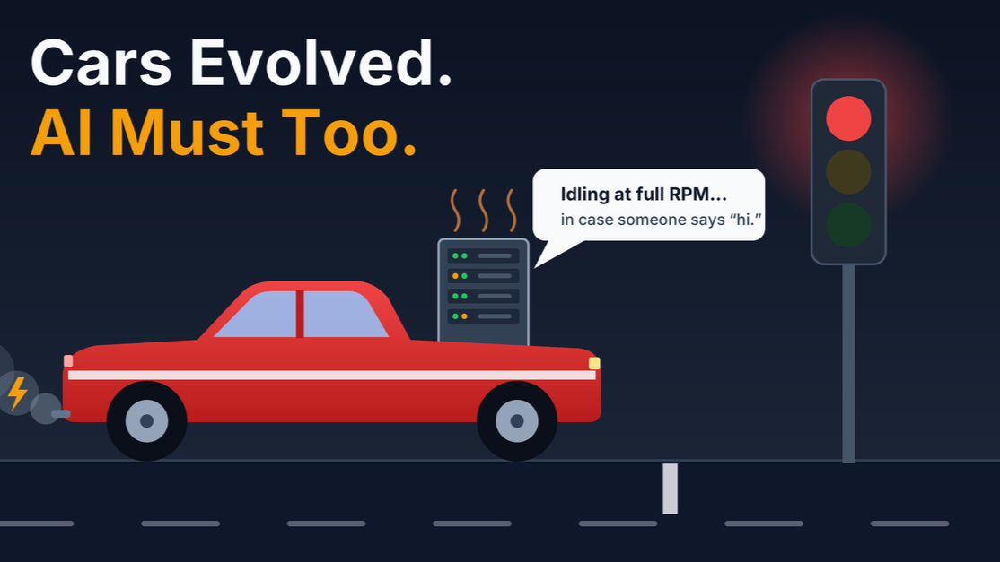

# Cars Evolved. AI Must Too.

*By Simon Nguyen · Originally published on [LinkedIn](https://www.linkedin.com/pulse/cars-evolved-ai-must-too-simon-nguyen-zidsc/)*

*Why AI burns electricity like a muscle car at a red light, and why that has to change*

AI has a power problem nobody likes to talk about.

Data centers are built for peak demand, but demand isn’t constant. People sleep. People commute. People forget their passwords at 2 AM. During those quiet hours, a huge amount of AI hardware just sits there, humming and glowing, burning electricity like a teenager eating snacks “because there might be a test tomorrow.”

Even when servers are busy, most requests are simple:

*“hi”*

*“summarize this”*

*“write a polite email because I messed up again”*

*“is a tomato a fruit?”*

and the classic: “explain quantum physics like I’m five.”

Only a small fraction of requests truly need a big, expensive accelerator. Providers may route them to different model sizes, but they still land on the same muscle-car hardware.

It’s like using a V8 truck to deliver one envelope.

### Cars already lived this story

Early cars were built when fuel was cheap. Engines were designed for power, not efficiency. They idled with every cylinder firing, and nobody cared.

Then millions of people started driving, fuel got expensive, and efficiency became survival: start-stop, cylinder deactivation, turbos, hybrids.

AI’s “cheap fuel” was cheap capital and a race for performance. Nobody optimized idle because nobody had to. That era is ending. AI is living in 2026 with the energy habits of 1926.

### Two problems: engine size and idling

*Engine size* is numeric precision. FP4, FP8, FP16, FP32 are the cylinders.

FP8 is a two-cylinder scooter. FP16 is a four-cylinder sedan. FP32 is a V8 that can tow a house.

More bits means more transistors switching, which means more energy per operation. The industry is already shrinking engines here, and that’s good progress.

*Idling* is the bigger problem. Clock speed is the chip’s RPM. In principle a GPU can slow down when it isn’t working. But once a model is loaded and “ready,” it can’t drop to true idle. Researchers measured an extra 26–66 W per GPU just from being ready.

It’s a car held at elevated RPM at every red light, all day, in case someone asks a question.

### The evolution of AI hardware (fun, but accurate)

• **GPUs: the muscle cars.** Massive power. Massive bills. Idles like a dragon sitting on a toaster.

• **TPUs: the hybrids.** More specialized, more efficient.

• **NPUs: the compact cars.** Great for short trips. Not for towing a boat.

• **Custom inference chips (like Microsoft’s Maia): the downsized turbo engines.** Small cylinders (FP4/FP8) for the heavy matrix math, bigger ones (up to FP32) only where needed.

• **What’s still missing: the EV moment.** Near-zero idle. Power that scales with the actual work.

Maia looks familiar to me. Early in my career I was part of a team designing an 8-DSP system sharing one global memory for MRI imaging. With HBM die-bonded right next to the compute, Maia can do something similar at far larger scale: many small engines fed from one shared memory. It also replaces NVLink with open Ethernet between chips, which I think is the right direction. What I haven’t seen published is any way to fully shut those engines down when nobody’s asking.

### The numbers (vendor-neutral)

•         Idle GPU power is about 20% of the chip’s rated power (2024 US Data Center Energy Usage Report). On a 700 W accelerator, that’s roughly 140 W of doing nothing.

•         In a month-long study of a real AI cluster, online serving spent 48% of its GPU energy in “execution-idle,” meaning loaded but not computing. In some production traces it reached 65%.

## Half the energy goes to waiting.

### What “start-stop” for AI looks like

1. **Pre-filter every request — on the CPU only.** I treat a tiny 1-bit-class model (like Microsoft’s BitNet) as the first stage of the LLM pipeline. It runs only on an ordinary CPU, never on a GPU, TPU, NPU or any other accelerator. Every time one of those wakes up, it costs power, so the filter itself must never wake them. It reads each request and decides how much engine it needs. “Hi” never wakes a GPU.

2. **Route to the smallest engine that can do the job.** NPU, TPU or GPU, chosen by need rather than habit.

3. **Shut off what isn’t needed.** Group accelerators so idle groups can be fully power-gated, not just clocked down.

The fair objection is cold-start latency. Waking a sleeping engine takes time. But research suggests the break-even point is about 1–5 minutes between requests. Below that, keep the engine warm. Above it, turn the engine off. This is exactly the decision start-stop makes in your car at every red light.

### Why this matters for free and paid AI

Free tiers attract users, and every user consumes power. Paid tiers only cover the cost if the hardware isn’t burning half its energy waiting. If AI keeps idling like a 1926 engine, the business model stays fragile. Efficiency isn’t optional. It’s survival.

### Closing

AI doesn’t need bigger engines. It needs smarter ones that idle low, scale fast and waste nothing.

## Cars evolved. AI must too.

### Sources

•         Execution-idle energy study (48% / 65% figures): [arxiv.org/pdf/2604.04745](http://arxiv.org/pdf/2604.04745)

•         “The Model Parking Tax” (26–66 W ready-state penalty; 1–5 min cold-start breakeven): [arxiv.org/pdf/2605.23918](http://arxiv.org/pdf/2605.23918)

•         Idle ≈ 20% of TDP: 2024 US Data Center Energy Usage Report (as cited in the Model Parking Tax paper)

•         Maia 200 (HBM3e, 750 W TDP, Ethernet scale-up instead of NVLink): Microsoft announcement, Jan 2026

•         Maia 200 precisions (tensor FP4/FP6/FP8; vector up to FP32): [glennklockwood.com/garden/processors/Maia-200](http://glennklockwood.com/garden/processors/Maia-200)

•         BitNet b1.58 / bitnet.cpp (ternary weights, CPU inference, 71.9–82.2% lower energy per token on x86): [arxiv.org/abs/2410.16144](http://arxiv.org/abs/2410.16144)

•         Maia 300 (HBM4, 288 GB, production 2027): [storagereview.com](http://storagereview.com/), Maia 300 article
