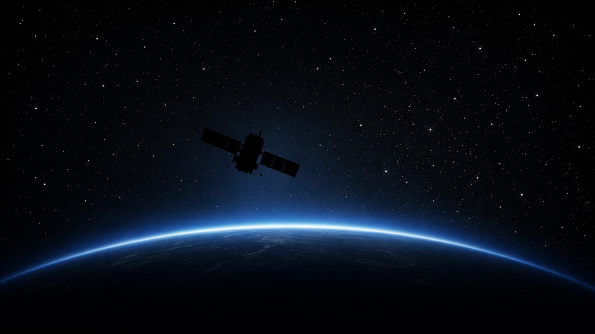

# The Hidden Engineering Challenges of Running Computers in Space

*By Simon Nguyen · Originally published on [LinkedIn](https://www.linkedin.com/pulse/hidden-engineering-challenges-running-computers-space-simon-nguyen-zbkmc/)*

I’ve been thinking about what it really takes to run compute in space — not from a business angle, but from an engineering point of view. Space is a very different environment, and a lot of assumptions we make on Earth don’t hold up there.

Here are the main constraints as I understand them.

### 1. Satellite Lifespan Is Short (3–5 Years)

Most satellites in low Earth orbit only last a few years. Radiation, battery wear, thermal cycling, and limited fuel all add up. When a satellite reaches end of life, it has to be de‑orbited and replaced.

Before that happens, all data on it must be moved:

cloned to a new satellitetransferred to nearby satellitesor downloaded to Earth

On Earth, servers can run 10–15 years and be repaired. In space, the whole system gets replaced.

### 2. Power Is a Hard Limit

Everything runs on solar panels and batteries. Half of each orbit is in darkness, so the system has to store enough energy to survive the night cycle.

This limits:

compute powerpanel sizebattery massthermal loadredundancy

Even though the Sun is strong, a satellite can only capture a small amount of it. Radiation and panel degradation reduce power over time.

### 3. Cooling Is the Main Bottleneck

On Earth, we cool computers with airflow and liquid systems. All of that depends on convection. Space has none.

### 3.1 No Convection

In space:

no fansno airflowno evaporative cooling

So Earth‑style cooling doesn’t work.

### 3.2 Liquid Cooling Only Moves Heat Internally

Heat pipes and liquid loops can move heat inside the satellite, but all waste heat still has to go through radiators.

The chain is:

## Chip → heat pipe → radiator → deep space

Radiators are the final limit.

### 3.3 Using Day/Night Cycles

LEO satellites get about 45 minutes of sunlight and 45 minutes of darkness. Radiators cool better during darkness.

Engineers can use:

heat pipesthermal switchesphase‑change materials

These help, but they don’t remove the core limit: **all heat must be radiated away, and radiator size caps compute power.**

### 4. No Repairs or Upgrades

If something breaks on Earth, we fix it. In space:

no repairsno upgradesno part replacements

One failure can end the mission.

### Key Engineering Questions

Instead of predictions, I think the useful questions are:

How much compute can realistically run in orbit?How does a 3–5 year replacement cycle affect system design?How do we handle cooling without convection?How much energy can we generate and store?What workloads actually make sense in orbit?

These are engineering problems, not financial ones.

### Perspective Disclaimer

This is based on my current understanding. I’ve never worked on orbital systems, so I may be wrong on some details. I’m open to corrections from people with direct experience.

