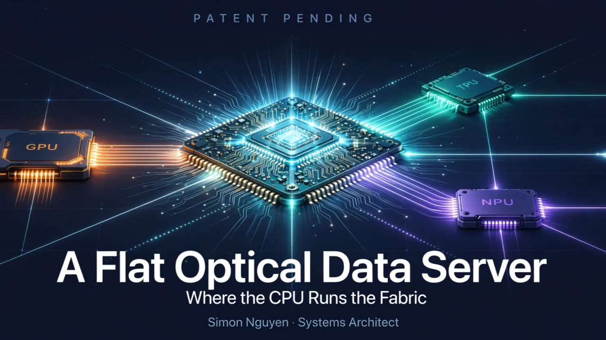
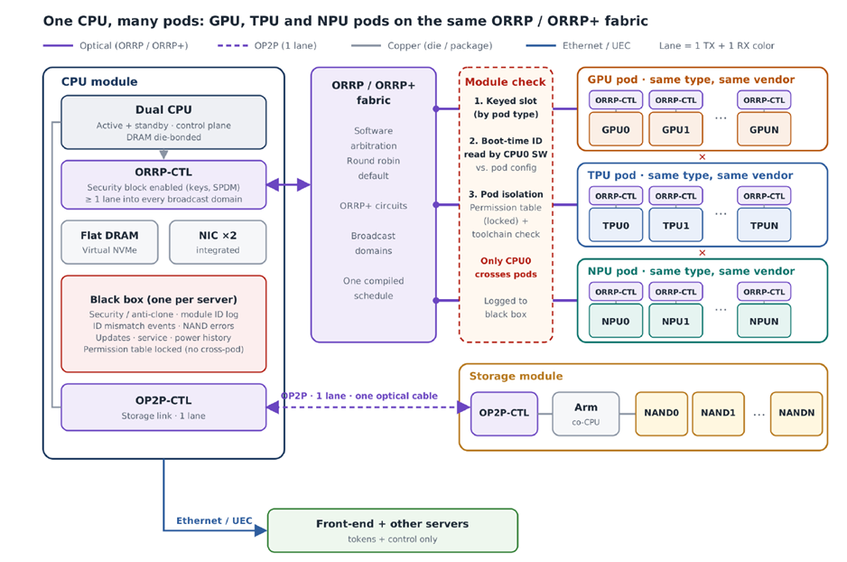

# A Flat Optical Data Server Where the CPU Runs the Fabric

*By Simon Nguyen · Originally published on [LinkedIn](https://www.linkedin.com/pulse/flat-optical-data-server-where-cpu-runs-fabric-simon-nguyen-eia0c/)*

Simon Nguyen · Systems Architect · November 2026, patent pending

In my earlier article, “Breaking the Infrastructure Wall,” I argued that AI servers need an open, modular, optical-first design. Since then I have turned that idea into a complete architecture, and I have now filed a U.S. provisional patent application on it. This article explains the main ideas at a high level.

### The problem

Today’s AI servers are built for peak performance, and that shapes everything else:

• **Copper and switch chips.** A rack-scale accelerator system uses hundreds of copper pairs per accelerator and dozens of switch chips. Copper limits reach to about one rack.

• **One vendor.** The interconnect usually belongs to one accelerator vendor, so mixing vendors is hard.

• **Idle power.** Many requests are simple, yet the whole system stays awake to serve them.

• **Storage failures.** Drives wear out and are replaced by a person. Unattended or remote data centers, and computing in space, cannot rely on that.

### The idea in one picture

*One CPU module, pods of GPUs, TPUs or NPUs on one optical fabric, and storage on its own optical link. Each pod holds one accelerator type from one vendor, so each vendor’s software runs unchanged.*

The server is “flat”: every module is a peer on light, not a card behind a chain of PCIe switches. Electrical wiring stays only for power and inside chip packages.

The hardware is meant to become a standard. The same CPU module, optical fabric and storage module can build a server with only GPUs, only TPUs, only NPUs, or any mix of them. The builder chooses the pods; the rest of the server stays the same.

Because each pod runs its own vendor’s software, the CPU can run different language models on different pod types at the same time, each model on the hardware that suits it best. Accelerator vendors then compete inside the same server on power and price, and that competition is what drives both down over time.

### 1. The CPU is in the loop

There is no separate fabric controller and no switch chip. The host CPU is itself an endpoint on the optical fabric and schedules it directly, the way a conductor leads an orchestra. It also controls power: when a request is light, the CPU can answer it from its own memory with a small model, and the accelerators stay asleep. Most chats do not need a GPU.

Putting the CPU directly on the optical fabric also removes the PCIe links, switch chips and bridges that sit between the CPU and the accelerators today, and the layers of legacy software that manage them. Data moves from memory to memory over light, with fewer hops, lower latency and less power. Each vendor’s own runtime still runs on its pod, but the path between them becomes much simpler.

### 2. One optical fabric, two ways to use it

• **ORRP, the shared broadcast layer,** carries control, small messages and model loading to many accelerators at once. Its traffic is scheduled and predictable, which suits accelerators whose work is planned ahead by a compiler, such as TPUs and NPUs.

• **ORRP+ adds point-to-point circuits** for bulk data, switched by fast optical elements while the broadcast layer keeps running. GPUs need this: they exchange large amounts of data between many pairs at the same time, so they use ORRP+ for parallel transfers.

So a TPU or NPU server can use the simpler, lower-cost ORRP, and a GPU server uses ORRP+, on the same CPU module and the same protocol.

Lanes, colors (wavelengths) and speeds are configuration settings, from low-power FPGA links to 800G and beyond. When more bandwidth is needed, you add lanes, not a new design.

### 3. Errors handled simply

Every endpoint checks what it receives and stays in step with the others. When something goes wrong, the transfer restarts from memory instead of keeping large replay buffers in hardware. This comes from many years of silicon validation, where I spent most of my effort on what happens when things fail, not when they work.

### 4. Storage that maintains itself

• **Memory as a fast disk.** Battery-backed host memory acts as a virtual NVMe disk. At power-up it is loaded with what the AI needs most, such as language-model key-value caches, so many requests never touch an accelerator.

• **Two copies, separate power.** Each block of data is kept twice, on different power buses, and repaired automatically.

• **Spare modules wait powered off.** Before a flash module wears out, the system copies it to a spare and switches over by light, with no technician needed.

This suits remote and unattended data centers, and space-based computing, as well as ordinary servers.

### Where it stands

The design is patent pending (U.S. provisional application, November 2026). I am being careful about claims: the architecture is complete, but numbers such as power per bit and latency against NVLink can only be proven with a prototype. My honest summary today is that this is an open, optical alternative for bulk and pairwise accelerator traffic, with better reach and modularity, and a path to self-maintaining storage.

### Where it comes from

My first job was a multi-DSP system for MRI medical imaging. Since then I have spent 25+ years in silicon validation, embedded systems and hardware/firmware co-design, contributed to USB standards, and spent about twenty years on power optimization. This design connects those old lessons with what AI infrastructure needs now.

If you work on AI infrastructure, optical interconnects or storage and want to discuss the architecture, I would be glad to talk.
