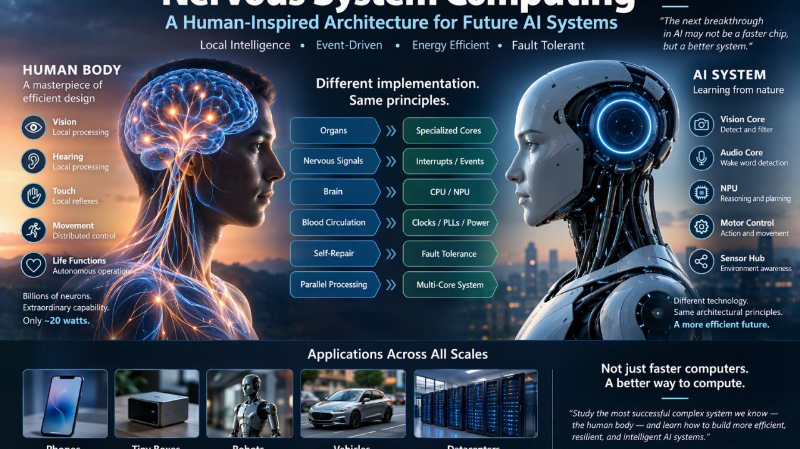
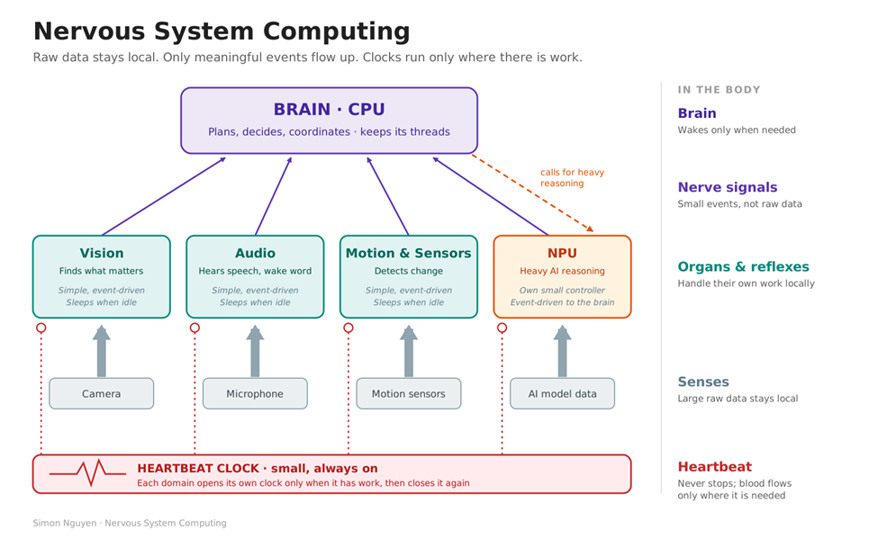

# Nervous System Computing

*By Simon Nguyen · Originally published on [LinkedIn](https://www.linkedin.com/pulse/nervous-system-computing-simon-nguyen-mslic/)*

*A Human-Inspired Architecture for Future AI Systems*

By Simon Nguyen

For more than fifty years, computers have been built around the processor. Applications create threads, the operating system schedules them, and processors execute them. This model has powered personal computers, enterprise servers, mobile devices, and the cloud. Artificial intelligence may require us to rethink it.

The industry’s main challenge is no longer raw compute. Modern processors already deliver extraordinary performance. The harder problem is efficiency. As AI moves from datacenters into personal devices, a growing share of energy goes not to computation, but to moving data, synchronizing components, managing memory, and keeping idle hardware powered.

There is a system that has already solved much of this problem, refined over millions of years of evolution: the human nervous system.

*Figure 1. A nervous-system architecture: specialized processors handle raw data locally and send only small events to the brain, while a small always-on clock lets each part wake only when it has work.*

*Figure 1. A nervous-system architecture: specialized processors handle raw data locally and send only small events to the brain, while a small always-on clock lets each part wake only when it has work.*

### Learning from the Nervous System

The body does not work as one giant central processor. Vision, hearing, touch, balance, and movement each do substantial processing locally before anything reaches the brain. The brain does not inspect every signal from every nerve cell. It receives summarized information, judges what matters, and decides when a decision is needed.

The nervous system communicates through events. A neuron fires only when its inputs cross a threshold, and many responses never reach the brain at all—a reflex pulls the hand away from a hot surface before we are even aware of the heat. For system-wide changes, the body uses chemical broadcasts: adrenaline shifts the entire body into a high-performance mode within seconds.

The result is remarkable efficiency. The brain runs on roughly twenty watts while coordinating tens of billions of neurons. It never fully rests; it is efficient because only a small fraction of its neurons are active at any moment.

Computers usually work the opposite way. Sensors forward large volumes of raw data to a central processor, which must filter, interpret, and coordinate nearly everything. As AI workloads grow, this centralization creates bottlenecks in power, memory bandwidth, and software complexity.

### From Central Worker to Central Brain

In a nervous-system architecture, specialized processing units analyze data locally and report only what matters. A vision processor identifies relevant objects before notifying the main AI engine. An audio processor detects speech or a wake word before a language model is involved. Motion, environmental, and communication processors interpret their own domains and raise events only when attention is needed.

Raw data stays local. Only meaningful signals flow upward.

The central CPU then acts as a brain rather than a worker for every task. Its job is planning, memory, decision-making, and coordinating the subsystems. When heavy reasoning is needed, it calls on the NPU, a powerful specialized organ, much as it calls on the vision or audio processors. Most of the time the subsystems run independently, and the brain is involved only when higher-level intelligence is required.

### Events Instead of Polling

This model leads naturally to event-driven computing. Many systems still rely on polling—repeatedly checking status even when nothing has changed. Event-driven systems reverse this: local processors stay active within their own domain and signal only when something significant happens.

Engineers have relied on interrupts for decades because they are more efficient than polling. AI systems could take this principle much further, making vision events, speech events, navigation events, and environmental events first-class operating system resources.

Polling still has its place. High-rate data paths such as storage and networking often poll on purpose, because at high event rates interrupts become more expensive than the work itself. The principle is to match the mechanism to the event rate: react to sparse events, stream dense ones.

### Making Events Practical

An event does not need to be complicated. In many chips I have designed, every interrupt source was a bit in one shared status register, with a full handshake: the source sets its bit, the receiver acknowledges it, and only then is the bit cleared, so no event is lost. A status bit says that something happened; a small message queue beside it can say what. The same idea scales beyond a single chip: across a server, events can travel as status messages over the system interconnect, where software reads and processes them.

Deciding what matters belongs in software, not in fixed hardware. Each specialized processor applies its own filters before raising an event, and the brain assigns priorities to the events it receives. Both can be updated as products and needs change. When a vision processor reports too often, the brain can raise its threshold—much as the body stops noticing a constant sound.

Simple does not mean unsupervised. Even a minimal operating system keeps timers: every request and every data transfer has a deadline, and if it does not complete in time, a callback handles the failure—retrying, resetting the domain, or reporting to the brain. When something goes wrong, each processor can record its recent events in a small trace buffer in its own local memory—the method I have used for years to debug silicon. The record is cheap to keep and invaluable when an event goes missing.

### An Operating System for Hardware Domains

During more than two decades of silicon validation, I learned that measuring a chip’s true performance and power required removing the operating system. Our test firmware ran bare-metal and interrupt-driven: cores slept until an event arrived, handled it, and returned to sleep. Only then could we see what the silicon was really capable of. The difference between those measurements and what the same chip delivers under a general-purpose OS is, in large part, the overhead this article describes. The goal is not to abandon the operating system—real devices need isolation, security, and updates—but to design one that lets products recover more of that hidden capability.

Threads were the right answer for single-core processors: they time-shared one CPU among many tasks. Multicore hardware no longer needs that sharing—tasks can own cores. Operating systems have added many multicore optimizations, but their basic unit is still the thread, a structure designed for sharing one processor.

Multi-threading became popular for a good reason: it lets engineers build independent tasks that are easy to develop and maintain. The cost is in execution. Context switches, thread migration, and locks add software overhead and repeatedly destroy cache locality. A domain-based design keeps the independence but changes the execution: the software stays modular, while the hardware stays warm.

A modern device is already a distributed system: CPUs, NPUs, GPUs, DSPs, image signal processors, sensor hubs, network controllers, security processors, and memory controllers, all on one chip or board. Managing these components efficiently now matters as much as keeping CPU cores busy.

Future operating systems may coordinate hardware domains rather than simply schedule threads. Instead of seeing the machine as a set of CPU cores, the OS would see a set of persistent services—vision, audio, planning, communication, memory, and user interaction—that communicate through structured events and messages. Dedicated cores or groups of cores could own a domain, reducing synchronization overhead, thread migration, and cache pollution.

Embedded systems already work this way: multicore controllers often run bare-metal code or a small RTOS on each core and communicate through mailboxes. Personal AI devices may be the place where this model finally reaches general-purpose computing.

This does not require rewriting the world’s software. The brain—the CPU—can keep its threads, because its work is varied and unpredictable, so applications and high-level software stay largely unchanged. The specialized processors—vision, audio, sensors, and the NPU—need simplicity: each one owns its cores, sleeps until an event arrives, does its work, and reports back. The change is concentrated in the hardware, firmware, and drivers that a few chip and platform vendors control, not in millions of applications. That keeps the cost of adoption low, and it lets each core be clocked, powered, and managed far more efficiently.

### Locality Over Frequency

Processor speed has grown much faster than memory speed, and fetching data often costs more energy than computing on it. For this reason, future AI hardware may gain more from larger local caches than from higher clock frequencies.

When critical code and data stay close to the execution units, they can be reused without expensive trips to external memory. The processor can then run at a lower frequency and voltage while delivering the same real-world performance. A predictable, domain-based software structure—with fewer migrating threads—makes those caches far more effective.

Simplicity has another benefit. When a specialized processor runs a tiny, event-driven program, the entire program can live permanently in local memory next to its cores. It never needs to fetch instructions from external memory, which saves both time and energy. As transistor scaling slows, chip area may be better spent on more local memory—even stacked on top of the processor—than on more complex logic. Large data, such as the weights of big AI models, will still need external memory, but the control software never has to leave the chip.

This trade-off must be managed carefully. Large SRAM arrays leak power even when idle, so extra cache capacity pays off only if unused portions can be power-gated when their domain is asleep.

### Power Like Blood Flow

Most of a chip’s dynamic power is spent on switching, and the clock network—which toggles on every cycle—is the largest consumer. Reducing clock frequency alone does not save energy for a given task; it only spreads the same switching over more time. The real savings come from eliminating unnecessary switching: stopping the clock wherever there is no work. An event-driven design does exactly this. Each domain’s clock runs only when an event gives it work, a fast-lock PLL brings it to speed instantly, and the clock stops again the moment the work is done. Like blood flow in the body, energy goes only where activity is happening.

I have seen this work in practice. Throughout my career, from my first startup to large semiconductor companies, I have architected chips in which the clock of every hardware block is controlled by software. Blocks run only when they have work, and the reduction in power consumption is dramatic. But fine-grained clock control pays off only when software knows exactly when each block is needed. Dedicated firmware knows this; a general-purpose OS juggling many threads usually does not, so clocks stay on “just in case.” An event-driven operating system would give the OS that knowledge—and turn hardware clock control from a capability into a real saving.

### Designing for Intermittent Humans

People do not operate at full intensity all day. Most of our time is spent observing, reading, listening, waiting, or doing routine tasks; intense reasoning comes in bursts. Systems built to serve people should reflect this.

A phone, wearable, home robot, or personal AI assistant spends most of its life waiting for something meaningful to happen, yet much of its hardware often sits in partially active states. Future designs should move aggressively between observing, interacting, reasoning, and sleeping. Fast-lock clock generation, intelligent power controllers, and AI-aware operating systems could wake resources only when needed and return them to low power immediately afterward.

Speed of waking matters. Today, restarting a chip’s clocks can take milliseconds—too slow for a system that must react instantly. The body suggests a better approach: the heart never stops, and each part of the body simply opens or closes its own blood supply as needed. A chip can work the same way. A small, low-power clock keeps running at all times and handles simple watching and listening. Faster clocks are brought up only when real thinking is needed, and work can begin at the slower speed while the faster clock gets ready. The response then begins in microseconds, not milliseconds. Specialized chips have used this approach for years; it has simply not yet become the organizing principle of general-purpose systems.

Here, too, the brain offers a model. During deep sleep it does not shut down; its electrical rhythms slow to roughly one to four cycles per second and its energy use drops—much like lowering a processor’s clock. It uses that quiet time for maintenance, consolidating memories and clearing waste. Devices could do the same: run at low clock and voltage when idle, while performing background housekeeping such as indexing, model updates, and memory compaction.

The goal is no longer maximum processor utilization. It is maximum useful work per unit of energy.

Personal devices show this most clearly. A phone or assistant exists to serve one human whose activity is intermittent, so it should spend most of its time conserving energy.

A future personal AI box, assistant, or home robot could resemble a digital nervous system: specialized processors watch their environment at very low power; event signals wake a central reasoning engine when needed; a decision is made and an action taken; and the reasoning engine returns to rest. Such a system would be designed not around perpetual computation, but around intelligent reaction.

### Not Only for Personal Devices

These ideas apply to datacenters as well. A datacenter seeks high utilization because its hardware is a large capital investment, but AI workloads are uneven: many requests are short and simple, and only some need a large accelerator. An AI server built like a nervous system would let the CPU handle simple work directly and wake its accelerators only when heavy reasoning is required, leaving the rest powered down.

The hardware trend makes this natural. Systems are increasingly built from many dies bonded together, and each die can have its own clocks that start and stop independently. Clock control then becomes fully distributed—across a chip, across a server, and across a datacenter. Idle hardware wastes power in a phone and in a datacenter alike.

### Independent Robots

The nervous-system model points toward robots that think for themselves, without depending on a datacenter. A robot cannot wait for the network to decide whether to stop; it must keep working when the connection drops; and the private life its cameras see should stay inside the home.

Robots still need software updates, and here the architecture helps again: each part can be updated separately, so improving vision never touches motor control. Like a brain consolidating memories during sleep, a robot can install updates while it charges, check itself, and wake up improved. And the owner—not only the vendor—should decide when updates happen, and be able to undo them.

### What Already Exists—and What Is Still Missing

Pieces of this vision already exist. Phones use always-on sensor hubs and low-power DSPs to detect wake words and motion without waking the main processor. Event-based vision sensors report only the pixels that change. Neuromorphic chips such as Intel’s Loihi and IBM’s TrueNorth compute with spikes rather than clocked instructions. Research operating systems such as Barrelfish have treated multicore machines as networks of message-passing nodes.

What is missing is a unified system architecture. These ideas usually appear as isolated optimizations—a low-power island here, a specialized accelerator there—while the operating system and application model still assume a CPU-centric world. The opportunity is to make event-driven, domain-based operation the organizing principle of the whole system: hardware, power management, operating system, and AI software designed together.

### Open Questions for Engineers

This article does not propose copying biology. Silicon and biology obey different physics and different engineering constraints. The aim is to identify principles worth exploring. Some starting points:

•        Can part of today’s thread, lock, and scheduler complexity be replaced by simpler event-driven designs, in which dedicated cores own functions and communicate through interrupts and message passing?

•        Can software manage clock domains, PLLs, caches, and power states as dynamically as the body allocates energy—enabling hardware only in response to events?

•        Can a more predictable software structure let processors use larger local caches effectively, so that reducing data movement matters more than adding memory bandwidth?

•        How should events be defined between processors from different vendors? Could a common, standard event interface prevent each company from inventing its own?

•        Who decides what a processor may ignore, and how can the brain adjust those decisions so that important events are not missed?

•        How are simple processors kept isolated, so that one compromised processor cannot read memory belonging to the others?

Other engineers will see other parallels:

•        fault tolerance inspired by biological redundancy

•        adaptive resource allocation, similar to how the body regulates blood flow

•        hierarchical decision-making modeled on the nervous system

•        distributed intelligence inspired by organs and neural networks

•        software architectures built around events instead of threads

### Eliminating Waste

The history of computing has largely been a pursuit of more computational capability. The coming decade may be defined by a different goal: eliminating waste. The most successful architectures may not be those with the most operations per second, but those that move the least data, synchronize the fewest resources, consume the least energy, and stay idle whenever possible.

Future gains may come from better transistors, new materials, or new memory technologies. Some of the largest may come from studying the most successful complex system we already know: the human body.

The purpose of this article is not to predict the future. It is to encourage exploration—and perhaps to teach computers to behave a little more like a nervous system, and a little less like a machine.

### Terms Used in This Article

**CPU:** the general-purpose processor. In this article, the “brain.”

**NPU, GPU, DSP:** specialized processors for AI, graphics, and signal processing (such as sound and images). In this article, the “organs.”

**Operating system (OS):** the software that manages the hardware and runs applications.

**Thread:** a single stream of software work that the operating system schedules on a processor.

**Context switch:** the operating system pausing one thread to run another, which costs time and disturbs the processor’s memory.

**Polling:** checking again and again whether something has happened.

**Interrupt / event:** a signal telling a processor that something has happened, so it does not need to keep checking.

**Bare-metal:** software that runs directly on the hardware, without an operating system.

**Cache / local memory:** small, very fast memory placed right next to a processor.

**Clock:** a steady pulse that sets a chip’s pace. Every pulse switches millions of transistors, and every switch uses energy.

**PLL:** a circuit that creates a fast clock from a slower one.

**Clock gating / power gating:** stopping the clock, or cutting the power, to parts of a chip that have no work.

**Die:** a single piece of silicon. Modern chips often bond several dies together.
