# Programmable Photonic QPU on a Flat Data Server

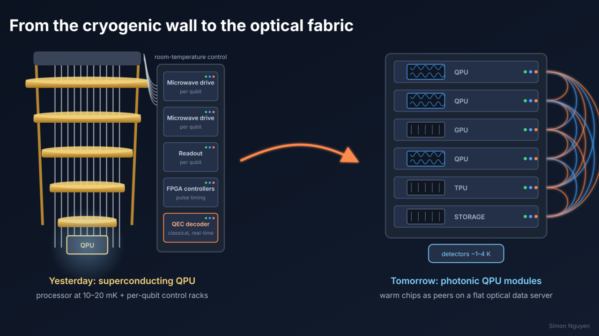

*By Simon Nguyen · Originally published on [LinkedIn](https://www.linkedin.com/pulse/programmable-photonic-qpu-flat-data-server-simon-nguyen-4mgkc/)*

Simon Nguyen · October 2026

***Author's note.*** *I am a systems and silicon architect (25+ years in validation, embedded systems and hardware/firmware co-design, starting with multi-DSP MRI imaging systems), not a quantum physicist. This document applies that systems view to photonic QPUs. The physics claims have been checked against published work (see Sources and the corrections tables), and I welcome corrections from quantum specialists*

## Executive summary

Every major shift in computing architecture has come from escaping a physical bottleneck. PCIe replaced the shared bus; optical fabrics are replacing copper's 1–2 m reach. Quantum computing now faces its own wall: superconducting qubits need the whole processor in a dilution refrigerator at 10–20 mK, with wiring and calibration that grow with every qubit.

Photonic QPUs avoid most of that wall. Qubits are photons on waveguides and fiber, most of the processor runs warm, and only the single-photon detectors need cooling (~1–4 K). This article proposes building and running them the way, the industry builds FPGAs:

**An optical FPGA.** A reconfigurable mesh of Mach-Zehnder interferometers sits over a standard base layer of co-packaged CMOS memory and optical multiplexing. Each application is a portable bitstream, merged at load time with per-chip calibration.**Automated quantum EDA with sign-off.** One flow compiles the application, places and routes photon paths, and signs off three things together: quantum correctness, photon loss and CMOS timing. No existing tool closes all three; that gap is the commercial opportunity.**Build-time assembly with pre-build emulation.** Each QPU is assembled once from catalog modules for a defined qubit count. The exact assembly is emulated and signed off before hardware is built, then checked against measurements afterward, the same flow as pre-silicon validation.**Native integration with the flat optical data server.** QPU modules are endpoints on the server fabric, next to GPUs, TPUs and storage. Error-correction data goes straight to GPU decoders on deterministic lanes, with no CPU in the path.

The architecture obeys three physics rules: a qubit cannot be read without being destroyed, every lost photon is an error, and photons must be identical and on time to interact. The deciding number is the photon loss budget per path. The classical side (control, interconnect, EDA, emulation) can be built within about 2–5 years. A large error-corrected photonic QPU depends on component loss improving, which puts it at 5–10+ years.

### Why photonics

A photonic QPU can be built and programmed like an FPGA, and plugged into a [flat data server](https://www.linkedin.com/pulse/breaking-infrastructure-wall-modular-opticalfirst-server-simon-nguyen-somzc/) as one more endpoint. This article lays out that architecture, the physics rules it must obey, and the open numbers still to size.

### Escaping the physical bottleneck

Every breakthrough in computing architecture comes from escaping a physical bottleneck. In personal computers, one shared parallel bus held every card back until PCIe replaced it with dedicated point-to-point serial lanes. In the AI era, copper links hit a reach wall: at 100–200G per lane, passive copper reaches only about 1–2 m (the IEEE 802.3 work on 212G per lane budgets passive cables at about 1 m). That keeps GPUs packed into power-dense, single-vendor racks.

Quantum computing now faces its own wall. The server is moving from a rigid tree to an open, flat optical fabric. Quantum hardware can take the same step: away from large, hard-to-scale dilution refrigerators, toward modular, FPGA-style photonic processors that are compiled by automated EDA, controlled by co-packaged CMOS with optical multiplexing, and plugged into the [flat data server](https://www.linkedin.com/pulse/breaking-infrastructure-wall-modular-opticalfirst-server-simon-nguyen-somzc/) as endpoints.

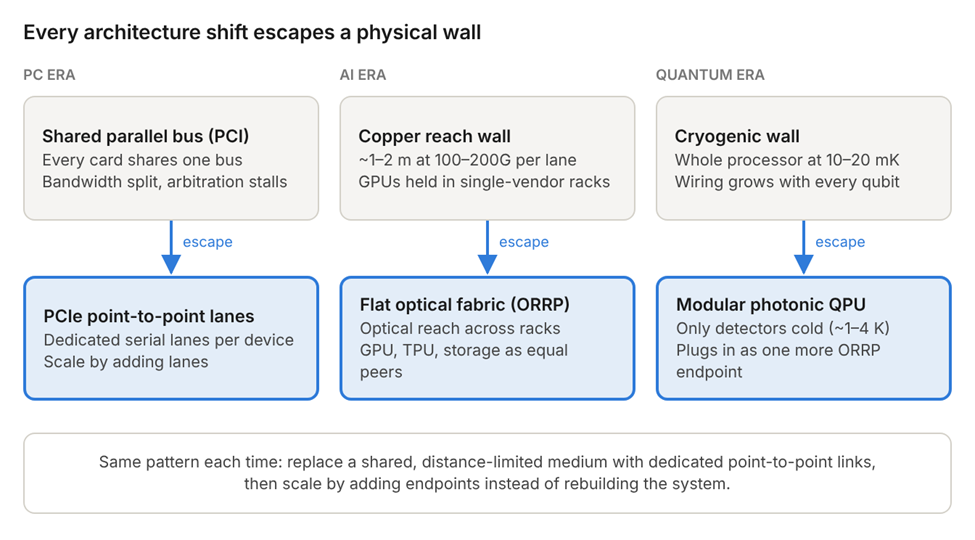

*Figure 1. The recurring pattern · shared, distance-limited medium → dedicated point-to-point links*

**Where the analogy stops.** PCIe and optical fabrics move classical bits, which can be copied, amplified and retransmitted. Qubit photons cannot (rule 1, below). The pattern carries over fully to the classical side of the QPU, and to the quantum side only as far as the loss budget allows.

### The scaling wall and the photonic alternative

For years the mainstream path has been superconducting qubits. They have reached real milestones, including error correction below threshold, but three physical limits stand in the way of large-scale deployment:

• **The deep freeze.** Every superconducting qubit must sit inside a dilution refrigerator at roughly 10–20 mK. Space and cooling power at the coldest stage are fixed per fridge.

• **The wiring problem.** Each qubit needs its own control lines (drive, and often flux and readout) running down through the cold stages. From dozens to millions of qubits, those lines become a heat load and a mechanical bottleneck.

• **Per-qubit calibration.** Each qubit has its own frequency, and its gates are tuned with shaped microwave pulses. Much of this is now automated in software (Quantum Machines reports multi-qubit calibration in minutes instead of hours), but calibration work, control channels and electronics still grow with every qubit, and all of it is tied to one fridge.

**The photonic alternative.** Instead of freezing the whole processor, a photonic QPU encodes qubits in photons that travel on waveguides and fiber. Sources, MZI mesh and CMOS control can run warm; only the single-photon detectors need cooling, to roughly 1–4 K. This removes the per-qubit cable bundle into a millikelvin stage and opens a path to scaling by adding modules. It does not remove calibration: phase offsets still drift and must be trimmed. The difference is that photonic calibration is a table of phase settings that CMOS applies automatically (Figure 5).

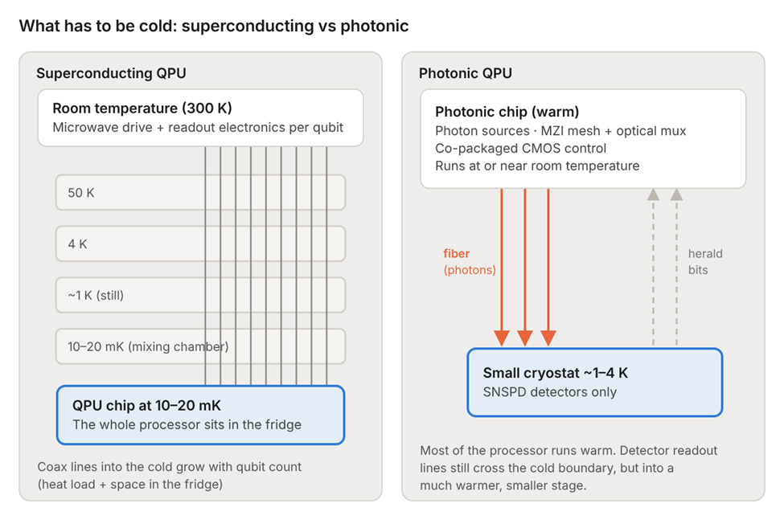

*Figure 2. What has to be cold · whole processor in a dilution fridge vs detectors only*

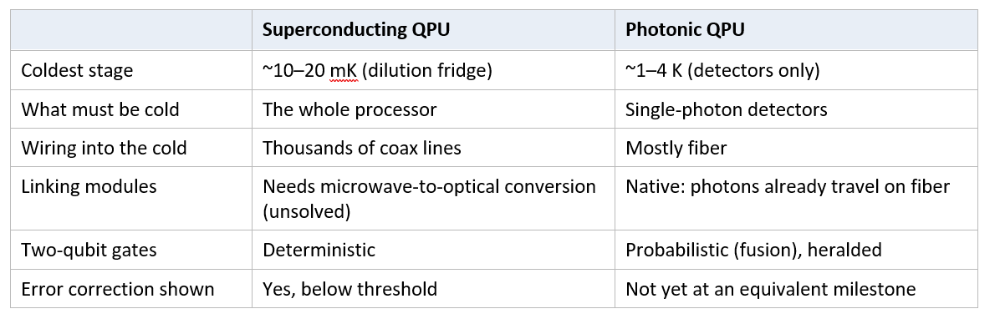

Temperatures are approximate. The trade in one line: photonics has the better scaling path; superconducting has better demonstrated performance today. Photon loss is the risk the photonic bet depends on.

### The three iron rules of working with light

Every design idea in this article was tested against three rules. Classical systems instinct (FPGA, LUT, DMA, WDM) carries over well, as long as it passes all three.

1. **You cannot read a qubit without destroying it.** No in-flight monitoring, copying (no-cloning), amplifying, retiming or buffering of qubit photons. Any optical-to-electrical conversion is a measurement.

2. **Every photon lost is an error.** Loss, not bit flips, is the dominant failure. Count the loss of every coupler, switch stage, mux and fiber on the path. 1 dB of loss ≈ 21% of photons gone.

3. **Photons must be identical and on time to interact.** Same wavelength, same pulse shape, arriving within picoseconds at the same beam splitter. Otherwise they cannot interfere, and no two-qubit gate happens.

A quick test for any new idea: does it read, copy or amplify a photon in flight (rule 1)? What does it add to the loss budget (rule 2)? Does it change a photon's wavelength or timing before a gate (rule 3)?

Figure 3 runs one photon through a typical inter-module path. Rule 2 applies at every stage, rule 3 at the beam splitter where two photons meet, and rule 1 at the detector, the only point where a photon can be read.

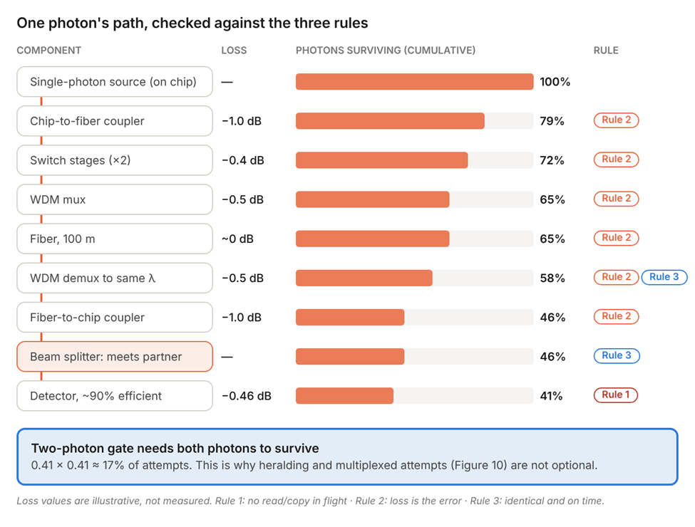

*Figure 3. One photon path against the three rules · illustrative loss budget*

Survival after L dB of loss is 10^(−L/10). Losses add in dB, so survival falls geometrically with every stage, and an operation that needs n photons to survive pays that fraction n times. This is why the loss budget, not bandwidth, decides how far this architecture scales.

### The Optical FPGA

The photonic mesh is a blank fabric of Mach-Zehnder interferometers (MZIs), like an FPGA's logic and routing fabric. Programming it means setting phase shifters, not changing hardware.

### From hand-tuned lab work to automated EDA

Classical electronics moved from hand-drawn layouts to EDA tools that synthesize, place and route logic automatically. Photonic quantum hardware needs the same step. Instead of hand-crafting each chip, an automated EDA tool defines, places and routes the optical muxes, demuxes and switchable components that implement the QPU's gates, then signs off the result against loss and timing (Quantum EDA flow, below).

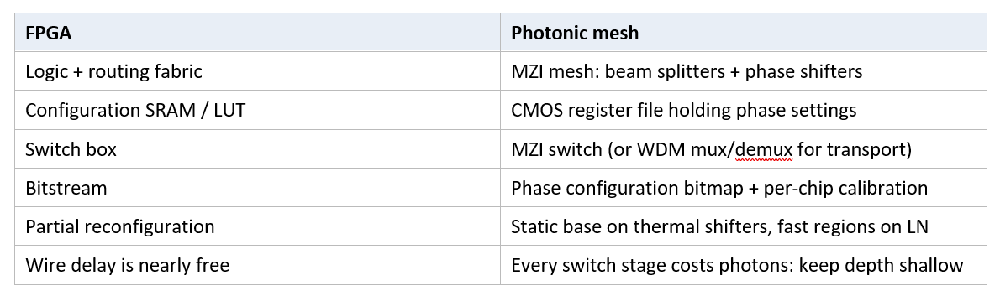

### A standardized base layer: CMOS memory + optical mux

Co-packaged CMOS memory and an optical mux layer form a standard foundation under the mesh. The base layer does not rewrite hardware for each application. It holds a pre-compiled configuration, applies it to the mesh, and reacts to heralds within nanoseconds. The same base layer serves a 1-qubit test configuration or an N-qubit application: what changes is the configuration loaded and the number of modules assembled, not the hardware.

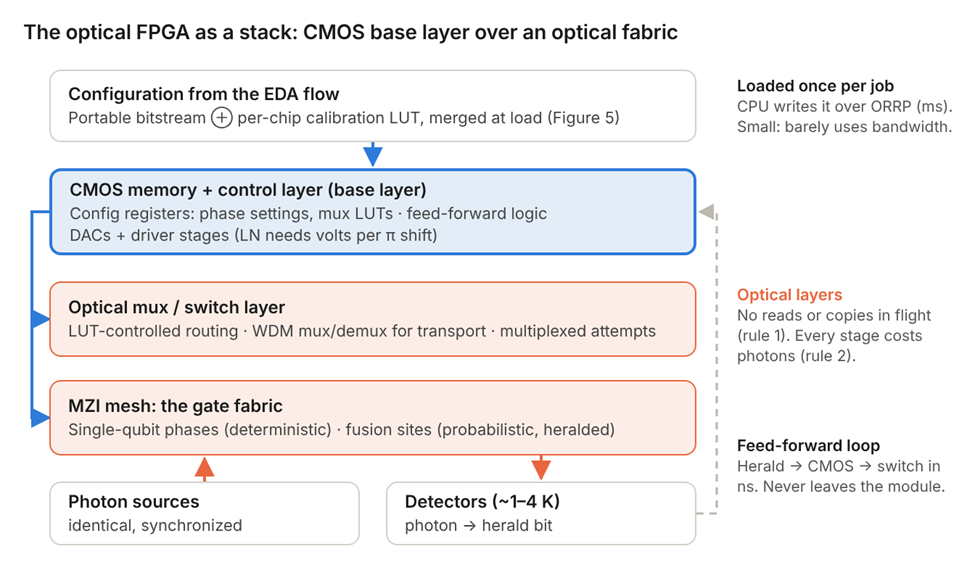

*Figure 4. The optical FPGA as a stack · CMOS base layer over the optical mux layer and MZI mesh*

**Precision note.** Gates themselves do not grow from 1 to N qubits; a gate acts on one or two qubits. What scales from 1 to N is the configuration footprint and the number of modules it spans.

## Two kinds of phase shifters, used together:

• **Thermal heaters:** stable, simple, but slow (microseconds to milliseconds). Use for static settings and drift trimming.

• **Electro-optic, e.g. thin-film lithium niobate (LN):** switches in nanoseconds, but its DC bias drifts and it needs a few volts per full π shift, more than advanced CMOS outputs, so driver stages are required. Use for fast reconfiguration and feed-forward. BTO is an alternative chosen by some vendors for foundry compatibility and cryogenic operation.

## Two kinds of gates:

• **Single-qubit gates** are deterministic: a phase setting on an MZI. The configuration bitmap handles them directly.

• **Two-qubit gates (fusion)** are probabilistic: they succeed only part of the time and announce (herald) whether they did. The control plane must react to that result within nanoseconds. This is the real reason fast LN switches matter.

**Thermal design note:** switching heaters on and off changes the chip's thermal equilibrium and causes more drift. Holding total thermal load constant is often better than gating idle heaters.

### CMOS control plane: three loops

The co-packaged CMOS controller's main job is fast feed-forward, not error monitoring. A photonic QPU is a quantum core wrapped in a large classical data problem: every detector produces classical bits that must be acted on at three different speeds.

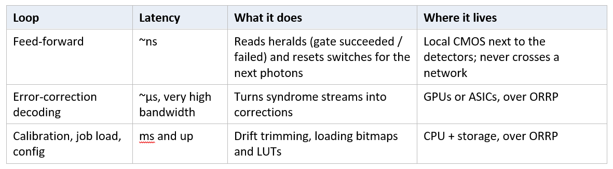

Drift correction does not come from watching live qubits (rule 1). It comes from tapped reference light and calibration cycles between runs. Degraded paths are routed around at calibration or compile time, not mid-computation.

Design rule: the CPU is never in the per-photon loop. It loads the configuration once per job; the CMOS holds it and makes every nanosecond decision itself.

### Programming model: LLM to bitstream

Each QPU application is a stored configuration, loaded like an FPGA bitstream. An LLM can start the flow, but only a deterministic, verified compiler may produce the final configuration: one wrong phase setting silently gives wrong answers.

1. **Text → LLM → quantum circuit** in a formal language such as OpenQASM. The LLM turns intent into an algorithm.

2. **Deterministic compile:** circuit → fusion / measurement pattern → MZI mapping → loss-aware place-and-route across the mux/demux mesh → configuration bitmap. Gate-to-MZI mapping is mathematically solved (Clements decomposition); routing optimization is where AI-assisted search can help.

3. **Verification and sign-off:** simulate the compiled configuration; check correctness, loss and feed-forward latency together.

4. **Load:** CPU merges the portable bitmap with the chip's calibration LUT and writes it to the CMOS.

5. **Run:** the CMOS does feed-forward on its own. Smaller ML models (not LLMs) help at runtime: drift calibration, and error-correction decoding on GPUs.

**Bitstream + calibration overlay.** An FPGA bitstream works on every chip of a part number. A QPU configuration does not: phase offsets differ per chip and drift over hours. Store the logical configuration as portable, the calibration as device-specific, and merge them at load time. This is what makes configurations reusable across a fleet.

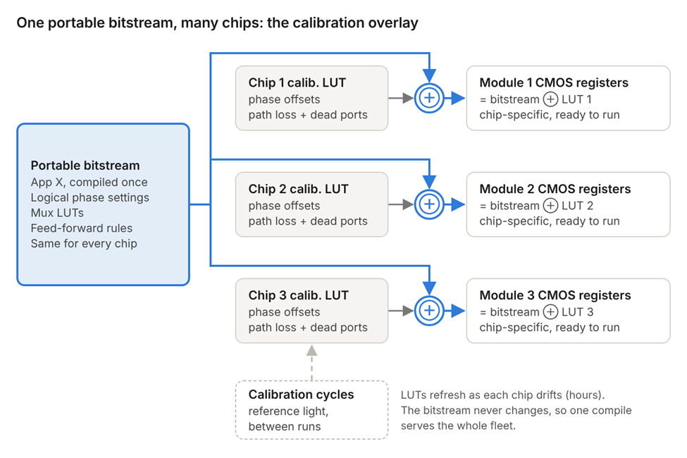

*Figure 5. Portable logic + device calibration · one compile, many chips*

### Quantum EDA flow

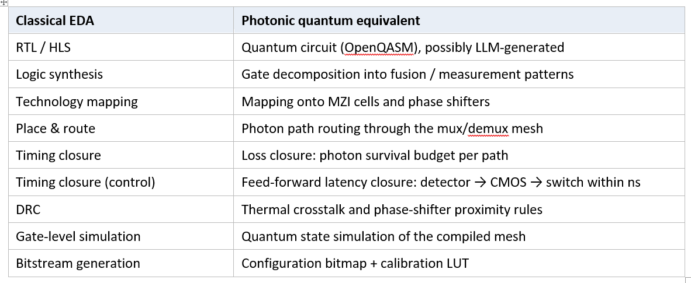

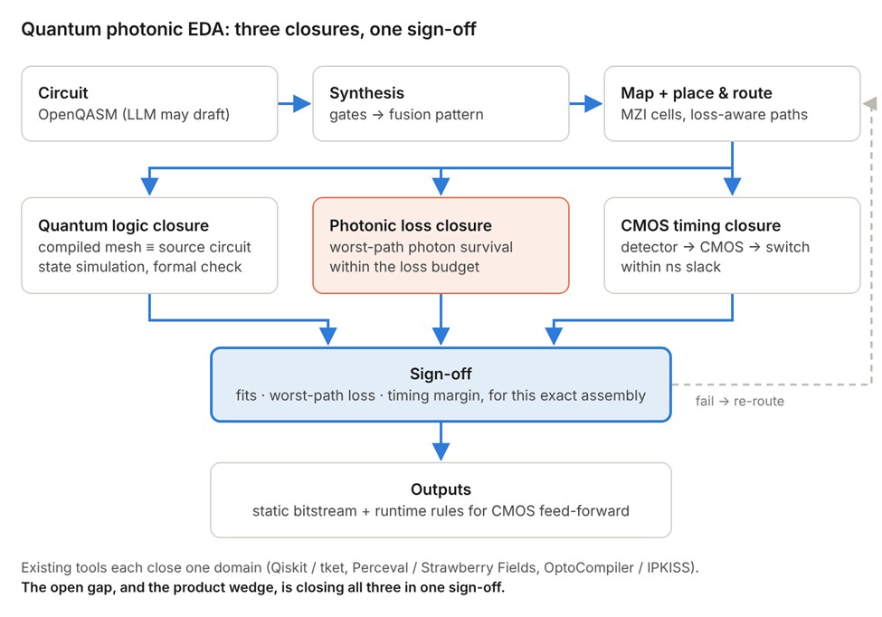

*Figure 6. Quantum photonic EDA · three closures feeding one sign-off*

Tools exist per layer: quantum compilers (Qiskit transpiler, Quantinuum tket), photonic circuit frameworks (Quandela Perceval, Xanadu Strawberry Fields), photonic layout (Synopsys OptoCompiler, Luceda IPKISS). The gap is a tool that closes all three domains at once: quantum logic, photonic loss and CMOS timing. A realistic wedge is sign-off: STA plus formal equivalence for quantum photonics, useful to every QPU vendor whatever compiler they use.

### System architecture

Each QPU module is one more endpoint on ORRP, so the [flat data server](https://www.linkedin.com/pulse/breaking-infrastructure-wall-modular-opticalfirst-server-simon-nguyen-somzc/) already holds every part an FPGA-style QPU system needs: a host to compile, storage for bitstreams, GPUs to decode, and DMA to move it all.

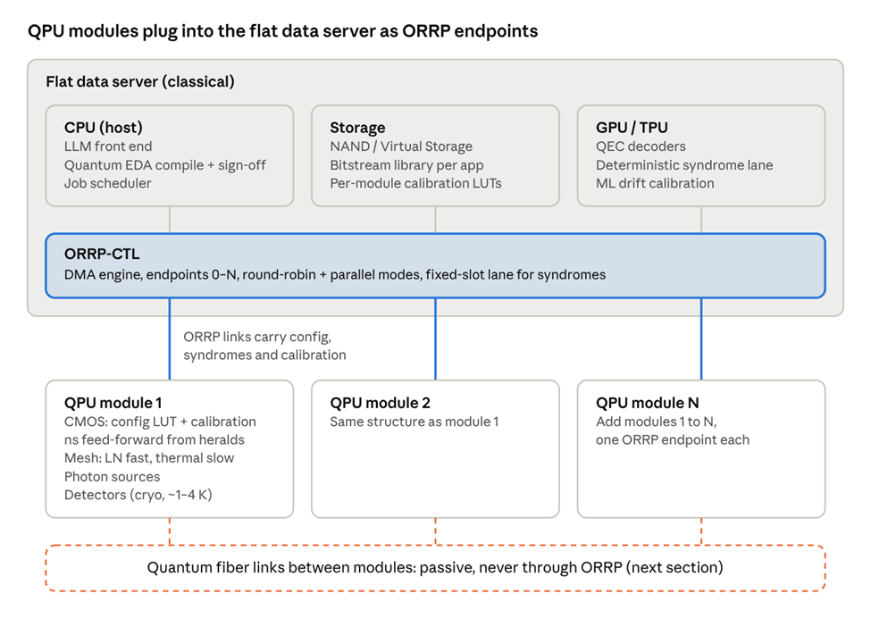

*Figure 7. System architecture · flat data server + QPU modules 1 to N*

Classical traffic (solid) runs over ORRP; quantum links (dashed) are a separate passive fiber network. The two never mix.

## Per-application flow:

1.       Choose the application; the CPU reads its bitstream from the library.

2.       Merge it with that module's calibration LUT.

3.       DMA the result over ORRP into the module's CMOS, which sets the mesh.

4.       Run: the CMOS handles ns feed-forward locally; syndrome bits stream over the fixed-slot ORRP lane to the GPU decoders.

5.       Load the next application.

For scale: NVIDIA's NVQLink, the closest industry equivalent, targets up to 400 Gb/s and under 4 µs round trip between QPU and GPU. One 1.6T ORRP lane exceeds that bandwidth; ORRP's latency must still be measured against the same target.

### Native acceleration on the flat optical data server

Anchoring photonic QPUs directly in the [flat data server](https://www.linkedin.com/pulse/breaking-infrastructure-wall-modular-opticalfirst-server-simon-nguyen-somzc/) gives three system-level advantages. Each one holds, but each needs a more precise statement than “all-optical”.

### 1. Fewer hops, not zero conversions

Qubit photons stay optical from source to detector; they have to, because any conversion is a measurement (rule 1). The classical side is different: every herald and syndrome bit starts as an electrical detector signal. So the flat server does not remove optical–electrical conversions. It removes the hops in between: no CPU copy through host memory, no PCIe switch tiers, no NIC-to-NIC network hops between the QPU and its decoders.

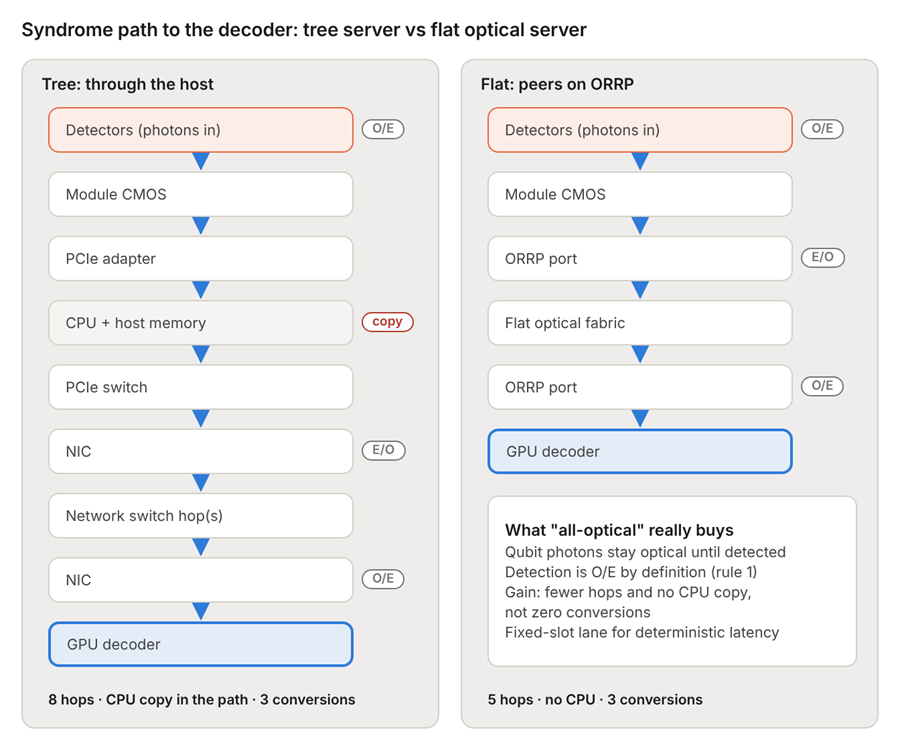

*Figure 8. Syndrome path to the decoder · tree server vs flat optical server*

Both paths have about three conversions. The flat path wins on hop count, on taking the CPU out of the per-cycle path, and on deterministic latency, which is what the decoder backlog rule (Sizing, below) actually needs.

### 2. GPU-assisted error correction, as peers

Quantum error correction produces a continuous stream of classical syndrome bits that must be decoded faster than they arrive. On the flat fabric, GPUs, TPUs and NPUs sit as equal peers to the QPU modules, so syndrome streams go straight to decoders over a fixed-slot ORRP lane without passing through a host CPU. This is the same goal as NVIDIA's NVQLink (QPU–GPU, under 4 µs round trip), reached through the general server fabric instead of a dedicated QPU–GPU link.

### 3. Power that steps with modules

Catalog modules let operators size a system from 1 to N modules and pay power for the modules installed and active. Power is not strictly proportional to workload, for three reasons: detector cryocoolers draw kilowatt-class wall power whether or not a job is running; thermal phase shifters should be held at a constant load because gating them causes drift (Thermal design note); and a parked module must be recalibrated before it rejoins. The accurate claim is that power scales in module-sized steps above a fixed floor.

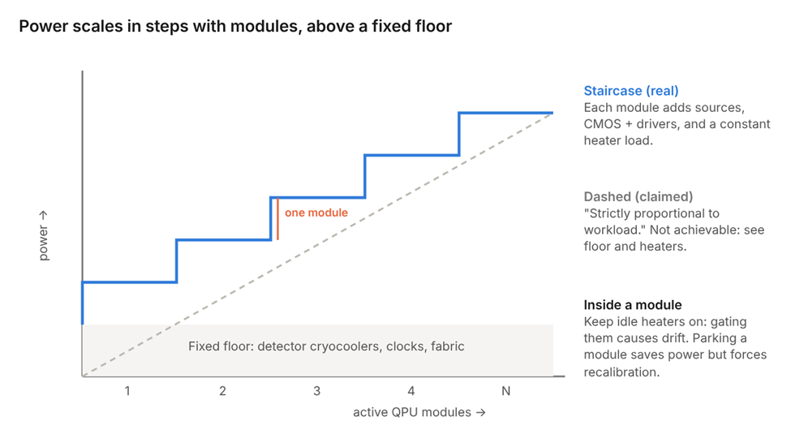

*Figure 9. Power vs active modules · staircase above a fixed floor (qualitative)*

### Scaling from 1 to N modules

Modules added at build time scale linearly on the classical side and are limited by loss and timing on the quantum side. Each module needs two separate networks.

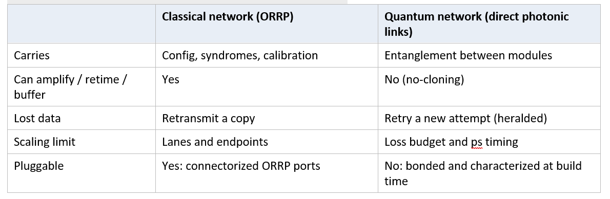

### The direct photonic link

Modules usually do not send the computation's qubit across the link. They create shared entanglement first, then use it.

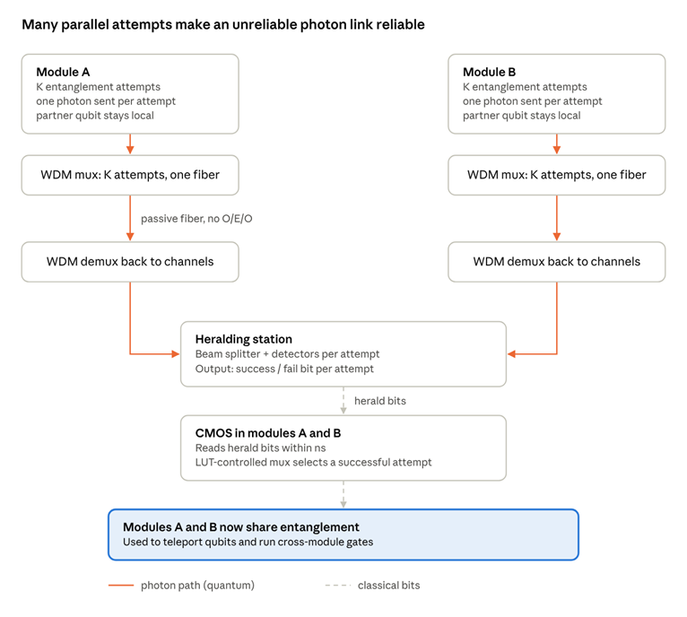

*Figure 10. Direct photonic link · multiplexed heralded entanglement between two modules*

Success is heralded: if a photon is lost, the detectors report a failure and that attempt is discarded. Loss then costs time, not correctness. Running K attempts in parallel and letting the CMOS pick a success with LUT-controlled switches is called multiplexed heralded entanglement; the FPGA-style switch fabric is the component that makes it work.

**WDM's role is transport only.** Many attempts share one fiber, which cuts connector count. Photons must be demuxed back to the same wavelength before they meet at the beam splitter (rule 3), and every mux/demux stage adds loss (rule 2).

**LUT routing vs physical fiber.** A LUT decides which path photons take, like FPGA switch boxes on fixed wires. It cannot remove the physical chip-to-fiber connection. Keep switch depth to one or two stages between modules.

### Module spec

•         One ORRP port (classical)

•         K quantum fiber ports to neighboring modules, ring or 2D mesh; the compiler places qubits to minimize cross-module traffic, like partitioning a design across FPGAs

•         Shared reference clock input: ps-level sync, matched fiber lengths

•         Cryo interface for detectors: per-module cryostat or shared backplane

Precedent: Xanadu's Aurora (Nature, 2025) networked 35 photonic chips across four server racks with 13 km of fiber. Reducing fiber-to-chip loss is the stated next challenge, which is exactly the loss budget this design must size.

### Customized QPU from catalog modules

The same tool and the same process build a customized QPU per application: choose which catalog modules to assemble, then compile a configuration for exactly that assembly. The module set is the "device" the EDA targets, like compiling for a multi-FPGA board instead of one chip.

**Build-time, not hot-plug.** “Plug-in” in this document means configurable at build time, not hot-pluggable. Each QPU is assembled once from catalog modules for a defined qubit count, with a known number of optical components. Quantum fiber links are then bonded (not connectorized) and characterized, and the EDA flow optimizes for that exact, known assembly. After the build, only two things change: the per-application configuration (bitstream) and the drift calibration (LUTs). This is closer to chiplet-based, configure-to-order design than to a hot-plug bus; the FPGA analogy still holds inside each module, where the MZI mesh is reprogrammed per application.

### Module types

Modules can be specialized, not just identical copies. Xanadu's Aurora already splits its hardware this way: 24 source chips, 6 multiplexer chips and 5 QPU chips.

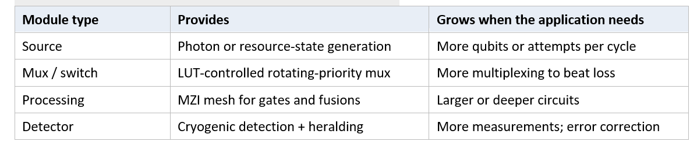

Customizing a QPU = **which modules** (hardware mix) + **how they are configured** (bitstream). A sampling application might weight toward sources; an error-corrected application toward detectors and mux depth.

### One flow for every assembly

1. **Enumerate:** each module reports its type, resources and ID, like PCIe enumeration.

2. **Characterize:** load each module's calibration and health map: loss per path, dead or weak ports.

3. **Compile:** map the application across the assembled system, minimizing cross-module links.

4. **Sign-off:** check fit, worst-path loss and feed-forward timing slack for this specific assembly.

5. **Load and run:** merge bitstream with calibration LUTs, load each module's CMOS, run.

The sign-off output is one statement, as an FPGA tool gives: *this application fits on this assembly, with this resource use, this worst-path loss and this timing margin.*

### Two speeds of "dynamic"

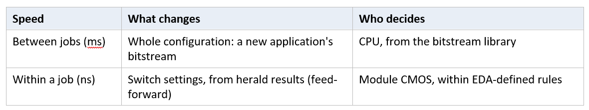

The EDA must output both: a static configuration and the rules for how the CMOS may change it at runtime. The second part has no real equivalent in classical FPGA tools; it is a new piece of this flow.

### Constraints the tool must enforce

• **Every hardware change forces re-sign-off.** The assembly is fixed at build time. Replacing a failed module in the field changes path losses and timing, so that assembly must be re-characterized and signed off again. Enumerate, characterize and sign-off must be automated so a service swap takes hours, not weeks.

• **Cross-module links are the scarcest resource.** Each costs entanglement attempts and time. The compiler treats inter-module link rate like routing congestion in classical place-and-route.

### Where per-application configuration adds the most value

Once a QPU is fully error-corrected, most applications run as software on logical qubits over one generic error-correction pattern. Configurable hardware matters most in four places:

• **Near-term applications** before full error correction, where a circuit tailored to the app wins directly

• **Choosing the error-correction scheme** per application: code type and distance, trading qubit count against error rate

• **Multi-tenant partitioning:** splitting one assembly among several jobs

• **Yield:** routing around defective switches and detectors so imperfect modules stay usable; possibly the most commercially valuable of the four

### Pre-build emulation: sign-off before hardware

Because each assembly is fixed before it is built, the EDA flow can emulate and sign off the exact design first, then check the real hardware against the model afterward. This is the same flow as pre-silicon validation. The difference is that the emulation must be hierarchical: no classical computer can fully simulate a large quantum computer, or the QPU would not be needed.

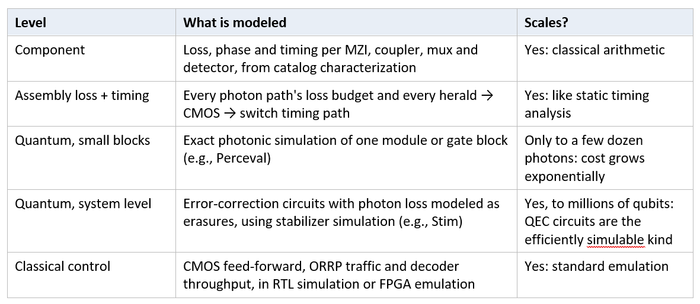

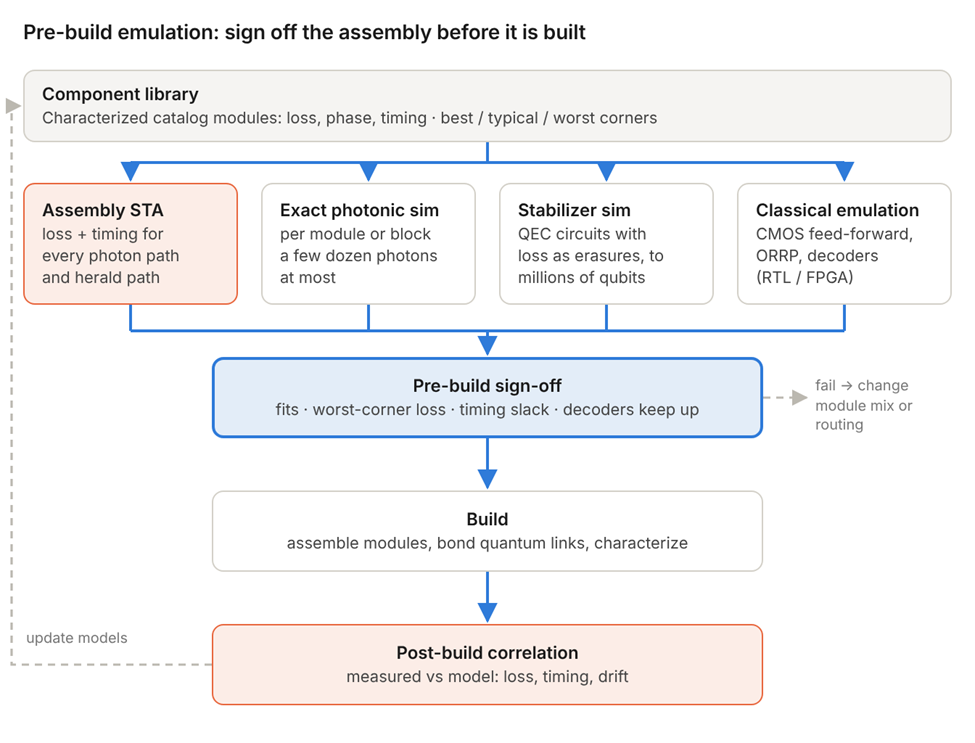

*Figure 11. Pre-build emulation and post-build correlation · hierarchical sign-off for a fixed assembly*

Sign-off rests on three legs: exact simulation per block, stabilizer simulation for the error-correction layer, and full classical emulation of the control and data path. The step from the logical algorithm to the error-corrected circuit is verified by the compiler's formal checks, not by simulating the whole machine.

• **Corners.** Catalog modules will vary in loss and phase the way silicon varies by process. Sign-off runs at best, typical and worst loss corners, not only at nominal values.

• **Post-build correlation.** After the assembly is built and characterized, measured loss, timing and drift are compared with the model, and the differences feed back into the component library. This is what makes the next build's emulation trustworthy.

• **Commercial value.** The emulation and sign-off environment is something a customer pays for before committing money to hardware, which strengthens the EDA wedge.

### Sizing: syndrome bandwidth

Syndrome bandwidth scales linearly with physical qubits, and slightly worse than linearly with logical qubits. Under illustrative assumptions, about 1,000 logical qubits fill one 1.6T ORRP lane.

Each error-corrected logical qubit costs about 2d² physical qubits (surface code, code distance d). Larger or longer algorithms need lower error rates, so d grows slowly with problem size.

*BW ≈ N_logical × 2d² × b × f_cycle*

b = bits per measurement, f_cycle = error-correction cycle rate.

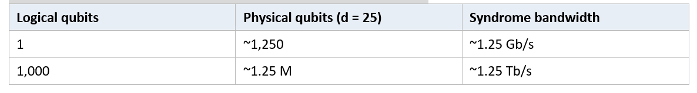

Assumptions: d = 25, b = 1 bit, f_cycle = 1 MHz. These are illustrative, not photonic-specific. Photonic fusion outcomes can carry extra bits (photon-number or erasure flags) and the clock may be faster: check against current PsiQuantum and Xanadu papers before relying on them.

**Decoder backlog rule.** If decoders run slower than syndromes arrive, the backlog grows exponentially and the computation stalls. Decoder throughput must stay ahead of syndrome rate at every scale. So deterministic link latency matters as much as raw bandwidth: ORRP needs a non-arbitrated, fixed-slot (TDM-like) lane class for syndrome traffic, separate from round-robin arbitration.

Configuration bitmaps are small; loading them barely uses bandwidth. Size ORRP for decoding traffic, not configuration.

### Corrections to the first draft

The first draft's architecture held up; six physics details did not. Each failed for one of the three rules, not because of the systems thinking.

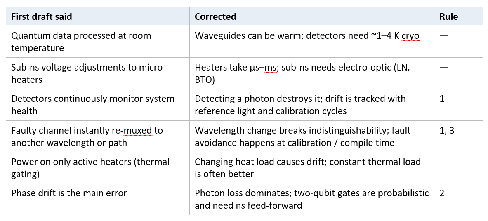

What held up and matches the field: the reconfigurable mesh as an FPGA, the co-packaged CMOS control plane, the EDA vs runtime-compiler split, and thermal crosstalk as a design constraint.

### Corrections to the added sections

The narrative added in this revision was checked the same way. Six statements needed tightening:

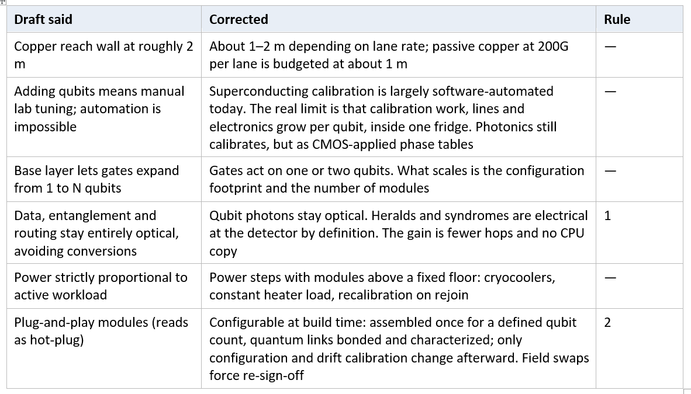

### Summary: a blueprint

Treat photonic QPUs like programmable FPGAs: a blank MZI fabric over a standard CMOS and optical mux base layer, configured by portable bitstreams that an automated EDA flow compiles and signs off, and merged with per-chip calibration at load time. Assemble those modules at build time into the all-optical flat data server as endpoints, emulated and signed off before any hardware is built, with GPUs, TPUs and NPUs decoding syndromes as peers on deterministic lanes. Quantum computing then moves from a fragile, hand-tuned physics experiment toward a scalable, efficient enterprise asset.

**One condition decides whether that holds:** the loss budget per path must close (Figure 3). Every open question below feeds into that number.

### Open questions and next steps

The loss budget per quantum link is the number that decides how far this architecture scales. Everything below feeds into it or depends on it.

☐      Size the loss budget per inter-module link: chip-to-fiber couplings + WDM mux/demux + fiber + switch stages

☐      From that loss, size the number of parallel heralding attempts, and so the mux width per link

☐      Size photonic syndrome bandwidth (bits per fusion outcome, clock rate) against current PsiQuantum and Xanadu papers

☐      Define the ORRP deterministic lane class for syndrome traffic; compare with NVQLink's published targets (up to 400 Gb/s, under 4 µs round trip GPU–QPU)

☐      Define the bitstream + calibration LUT format

☐      Choose the bonding process for quantum fiber links (fused or bonded) and its loss per joint; connectors only on classical ORRP ports

☐      Build the component model library and loss corners for pre-build emulation; plan post-build correlation

☐      Decide per-module cryostat vs shared cryogenic backplane for detectors

☐      Learn measurement-based quantum computing (MBQC) and fusion-based quantum computing (FBQC): the models photonic machines actually run on

### Glossary

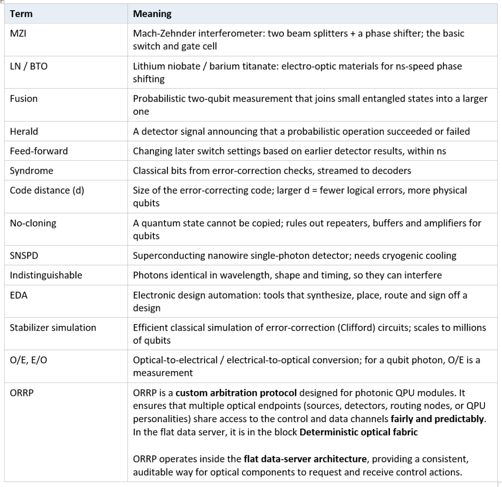

### Sources

• [Xanadu Aurora: 12 qubits, 35 photonic chips, 13 km fiber, four networked racks (Nature, Jan 2025)](https://www.eejournal.com/industry_news/xanadu-introduces-aurora-worlds-first-scalable-networked-and-modular-quantum-computer)

• [Xanadu and Corning: fiber-to-chip loss is the key challenge for scaling Aurora](https://quantumcomputingreport.com/?p=33000)

• [Aurora system detail: source, multiplexer and QPU chips; cryogenic detectors](https://www.hpcwire.com/?p=180688)

• [NVIDIA NVQLink: open QPU–GPU interconnect for real-time QEC (Oct 2025)](https://thequantuminsider.com/2025/10/28/nvidia-launches-nvqlink-to-bridge-quantum-and-classical-supercomputing/)

• [NVQLink targets: up to 400 Gb/s, under 4 µs round trip](https://quantumcomputingreport.com/nvidias-nvqlink-unites-quantum-ecosystem-for-real-time-error-correction/)

• [PsiQuantum switch networks for FBQC: feed-forward and multiplexing](https://calendars.illinois.edu/detail/7046/33433976)

• [PsiQuantum Omega chipset (Nature, 2025); FBQC paper (Nature Communications, 2023)](https://www.jaredwatkins.com/research/quantum-computing/psiquantum/)

• [Quantum Machines QUAlibrate: automated superconducting calibration, hours to minutes (May 2025)](https://thequantuminsider.com/2025/05/19/quantum-machines-launches-open-source-framework-that-cuts-quantum-computer-calibration-from-hours-to-minutes/)

• [212G per lane connectors and cables: passive copper DAC budgets at about 1 m](https://www.designworldonline.com/new-developments-in-212g-per-lane-data-center-connectors-and-cables/)

• [Stim: a fast stabilizer circuit simulator (Quantum, 2021)](https://quantum-journal.org/papers/q-2021-07-06-497/)
