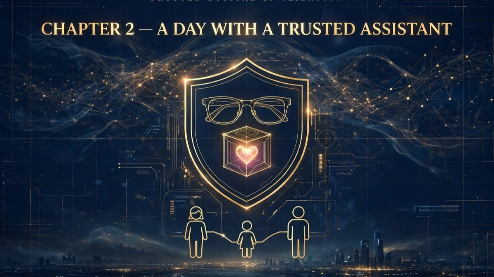

# THE TRUSTED DIGITAL CIVILIZATION Chapter 2 — Living with a Trusted Assistant

*By Simon Nguyen · Originally published on [LinkedIn](https://www.linkedin.com/pulse/trusted-digital-civilization-chapter-2-living-assistant-simon-nguyen-vacpc/)*

Simon Nguyen

Patent Pending — filed October 23, 2026PART I — WHAT TRUST GIVES BACK

Today, much of life is spent proving who we are and guarding against those who pretend. Passwords, forms, ID checks, warnings about scams, calls to check that a parent is safe. Each one is small. Together, they take a large part of our time, our attention and our peace of mind.

When trust is built in, that weight lifts, and what it gives back is human.

**Time to care.** A daughter who no longer worries every evening can spend that call simply talking with her mother. Caring becomes a choice of love, not a duty of fear.

**Honesty becomes normal.** When fake identities cannot work, cheating loses its easiest path. Technology cannot make anyone good. But it can stop rewarding those who are not.

**Focus on real work.** Doctors spend their time on patients, not paperwork. Officers focus on real risks, not routine checks. Workers in every field get back the hours that suspicion used to take.

**Stable families, stable society.** Families are protected from the scams that drain savings and break trust between generations. Children grow up knowing they are not watched in secret. Older people stay independent longer, with dignity.

Trust is not the goal. It is the foundation. This chapter shows what it looks like — first in one person’s ordinary day, then across a whole society.

## PART II — YOUR DATA, YOUR HOME

User Trust Data (UTD) belongs strictly to the individual—like your own house, your land, or your private property. Just as you control who enters your front door, hardware-anchored identity ensures you remain in control of your digital life.

When identity is anchored in hardware you own, companies no longer act as high-risk custodians of raw personal information. They receive only signed tokens that reveal just what is needed. That frees them from the liability of holding personal data, and lets them prove they handled it lawfully, without ever holding it.

True freedom, however, thrives when accompanied by shared guidelines and mutual respect. Because people have different levels of digital experience, simple and fair rules help protect everyone—especially the most vulnerable. These common-sense safeguards are not about restriction or control; they are about creating a safe, trustworthy environment where people can live with kindness, care, and peace of mind.

When system access is transparent, every action leaves a clear record, and no one—whether a corporation or an authority—can look in secret. Clear rules keep institutions honest, protect individual dignity, and ensure that technology serves human well-being above all else.

This is the foundation for the 21st century: a framework built on personal privacy, shared responsibility, and trust that stands on solid ground.

## PART III — A PROMISE KEPT

On June 20, 2026, the first chapter of this series explained why AI must operate inside a trusted ecosystem, built on UTD — User Trust Data, each person’s own private digital identity. It promised that the hidden hardware would come next. The design is now patent pending, so I can share it.

## PART IV — WHAT AI SHOULD BE

AI is a tool. Like every powerful tool, it can make life easier, or it can make harm easier. A tool that helps one person write a letter can help another write a scam. A tool that can make a video can make a fake one.

To see why AI matters, think of the farmer, and how each new tool changed the work:

1. **Hands.** Farming began as hard labor from sunrise to sunset: digging, planting seed by seed, harvesting with a blade.

2. **Animals and the plow.** An ox and a plow did the work of many people. The farmer still worked hard, but could farm more land.

3. **Machines.** The tractor and the combine replaced the animals. One farmer could now do what once took a whole village.

4. **Computers and GPS.** Tractors began to steer themselves in perfect lines, and the farmer could measure every field, row by row.

5. **AI.** Today, machines can see a single weed or a sick leaf, and treat just that plant. Sensors tell the soil when to drink. The farmer no longer carries the load. The farmer guides the machines.

At every step, the tool took away heavy, repetitive work, and the same land fed more people. The farmer’s job did not disappear; it moved from muscle to judgment.

AI is the next step, not only on the farm, but in every part of life. It can take away the forms, the passwords, the waiting and the worry, so people can spend their time on what matters.

But there is one difference. A tractor cannot pretend to be someone else. AI can. That is why, for AI, trust is not optional. It is the foundation.

AI should make life easier for people, and harder for those who want to harm them.

What matters is not how smart the tool is. It is how it is built. Most harm in the digital world depends on two things: a fake identity, and an act no one can see. Remove those, and the same tool that helps honest people gives nothing to those who want to cheat.

That is what this design does. It gives the AI two devices the person owns. Glass is eyewear that holds the person’s identity in secure hardware. Tiny Box is a small pocket device that does the computing. Every action has a real person behind it, and every access leaves a record.

The AI does not judge people. It simply never hands anyone a mask. It serves the person who owns it, and it is built so it cannot be turned against anyone else.

**With trust, AI becomes security for everyone. Without it, AI is just another software tool, and the more powerful it becomes, the more dangerous it can be.**

I am not writing this to slow AI down. I believe in AI, and I want to move it forward. Trust is not the brake on AI. It is what lets us use AI everywhere it can help — in our health, our homes, our money and our families — safely.

## PART V — WHEN THE ASSISTANT LEARNS TO HEAR FOR YOU

A man in his seventies has started to miss words at the dinner table. His family repeats themselves; he smiles and nods. Slowly, he talks less.

He already wears Glass. One day he adds the optional hearing earphone.

He does not open a settings menu. He does not download a new app. The assistant notices the new earphone and asks him quietly: “I see a hearing earphone. Would you like me to help you hear better?” He says “OK”.

The assistant runs a short listening check — a few tones, a few words — and builds his personal hearing profile. The profile stays on his own devices.

From then on, the assistant adjusts to his day. At a noisy restaurant, it brings his grandson’s voice forward. In the car, it softens road noise. When his hearing changes over the months, it notices and suggests a new check. It never changes his settings without asking.

He never had to learn a new device. The assistant learned him.

## PART VI — A HEALTH PARTNER THAT IS ALWAYS WITH YOU

A woman walks every morning. She doesn’t wear a watch or a chest strap. Her Glass already reads her heart rate, and the assistant keeps her pace right: “You’re in your target zone. Five more minutes?”

Over months, the assistant learns what normal looks like for her: her resting heart rate, how quickly she recovers after exercise, and how her heart and temperature patterns change through the day. Heartbeats vary, so it never judges one reading. It watches the pattern. It does not diagnose. It notices changes.

One month, the pattern suggests her blood pressure may be rising. The assistant does not give her a number it cannot trust. It says: “Your heart signals suggest your blood pressure may be higher than usual. A few readings with a cuff this week would confirm it. Would you like a reminder?” The cuff confirms it.

At her checkup, she says “OK”, and for the length of the visit her doctor sees a simple daily picture:

• **Morning:** her resting heart rate and temperature right after waking — her true baseline

• **Exercise:** how high her heart rate climbs on her walk, and how fast it comes back down

• **Work:** how her heart responds to a long, busy day

• **Before sleep:** whether her body slows down and settles at night

One reading in a clinic shows a moment. A month of mornings, walks, workdays and nights shows a life. The doctor decides what it means. When the visit ends, the access ends, and no copy stays behind.

## PART VII — FAMILY, WITH PERMISSION

Her mother is 82 and lives alone, an hour away. She is proud of her independence and does not want to be watched. But she also does not want to fall one day with no one knowing.

So she decides, with her assistant, what her daughter may see: a daily “all is well” signal, her health summary, and her location only when it is needed. Her son gets less — just the emergency call. That is her choice too.

Even with permission, the assistant still asks her each time: “Your daughter would like to see how your week went. Share it?” She says “OK”, or “not today”. Permission is not a blank check.

Emergencies are different, and she decided in advance how they should work:

•     If she falls, does not respond, and her Glass shows her heart signals are in danger, the assistant calls 911 and her daughter at the same moment. In those minutes, nothing should wait.

•     If she falls and her Glass has come off, so the assistant cannot read her signals, it alerts her daughter first. If no one confirms she is OK within a few minutes, it calls 911.

•     If she simply has not answered for a while, the assistant checks in with her first. Only if there is still no answer and no movement does it alert her daughter, with her location.

She can see every time someone looked, and she can change or take back any permission at any moment — quietly, without explaining herself to anyone. If one day she cannot decide for herself, the person she named in advance can step in, only for what she allowed.

Her daughter no longer calls every evening with the same worried question. When she calls now, they talk about other things.

## PART VIII — CHILDREN, WITHOUT SECRETS

Tracking children is a hard question. Parents need to know their children are safe. Children need to grow up without feeling watched.

The assistant follows the same rule as for everyone: no one is watched in secret. When a parent checks a child’s location, the child is told privately: “Mom checked your location at 3:42 pm.” The child can see every access, with the date and time. As the child grows, the parents can widen the child’s privacy, step by step.

In an emergency, nothing waits. If the child is in danger, the parent’s access goes through at once, and no notice is shown until the child is safe.

On the child’s 18th birthday, all parent permissions end. The young adult now holds the keys to their own identity.

## PART IX — THE CAR THAT KNOWS ITS DRIVER

It’s a cold morning. Before she reaches her car, the assistant tells her: “It’s 2 degrees outside, with ice on the road. Your car is 80% charged — enough for today. Should I warm up the seat and the windshield?” She says “OK”. By the time she gets there, the car is ready.

The car does not need a key. It knows her: her seat, her mirrors, her music. When her son borrows the car, she gives him a permit for the weekend. When the weekend ends, the permit ends.

On the road, the assistant watches over her. Many cars notice drowsiness only when the steering starts to drift — by then, the danger has already begun. Glass sees her eyes up close at every moment, and it feels her heartbeat too. It can notice the first signs of sleep, or warning signs from her body such as a very irregular heartbeat, before the car can see anything wrong. The assistant warns her, then warns louder, and tells her to pull over. If she cannot respond, Glass tells the car, and in cars that support it, the car helps bring itself to a safe stop. Glass watches the driver; the car watches the road.

Her driving data stays with her. The car company sees it only with her “OK”, every access is logged, and she can take it back at any time. But a simple “OK” is only as safe as the question behind it. So the assistant explains every request in plain words — who is asking, what they would get, and for how long — and warns her when a request asks for more than it needs.

She doesn’t have to worry about her data. Her assistant does that for her, and she stays in control.

## PART X — TRAVEL WITHOUT PAPERS

At the airport, a traveler wearing secured Glass simply walks through. No ID card, no passport, no boarding pass: the gate already knows who she is, and that her ticket is valid.

The airline receives a token — “verified passenger, ticket valid” — not her personal data. At the border, the officer’s system receives “verified passport holder, cleared”. Her health records, her contacts and her history never leave her devices.

The record of her trip — the date, the flight, the border she crossed — is kept by both sides: in her own devices and in the government’s records, as travel records already are by law. Both hold the same signed record, so neither side can change it, and either side can prove what happened.

Glass replaces the identity check, not the security screening; bags are still scanned. When every traveler’s identity is certain, screening can be faster and focused where it matters. Anyone may still be selected for a random check, because security that can be predicted can be beaten. Travelers without secured Glass are checked the familiar way.

Abroad, each country chooses to join, by agreement, building on the digital travel credentials the world is already preparing.

## PART XI — MONEY, WITH A SECOND PAIR OF EYES

Banks will build their own AI tools on top of the applications people use today. They do not need to start over. With secured Glass, they gain what they have always lacked: certainty about who the customer is.

No banking through her assistant can happen unless her Glass is on her face. At the ATM, at the bank, or in an app, every banking action begins the same way: Glass confirms it is being worn by her, and only then does Tiny Box sign a one-time token. A stolen card gives a thief nothing, because there is no card. A stolen Tiny Box is very hard to use, because it needs her and her Glass.

The bank’s AI offers her a new credit card with a special rate. Her own assistant reads the details: “The rate goes up after six months, and there is a yearly fee. You don’t need it based on how you spend.” She says no. The bank’s AI works for the bank. Her assistant works for her. And she decides.

One afternoon, right after a call from an unverified number, she starts to send $5,000 to a new account. Her assistant stops her for a moment: “This transfer came right after an unverified call, to an account you have never paid before. This is how many scams work. Do you want to call your bank’s verified line first?” That moment can save a life’s savings.

If someone forces her to withdraw money, the assistant can sense it. The withdrawal appears to work, but with limits, while help is called silently. If her Glass is lost or broken, she can still bank the familiar way, at a teller with an ID, until her new Glass is restored. No one is locked out of their own money.

## PART XII — GOVERNMENT, WITHOUT THE LINE

Renewing a driver’s license today means forms, documents, a photo and often a long wait. With secured Glass, she renews it from home: her identity is confirmed, her alertness tokens show “safe”, and the agency issues the renewal, if its rules allow. No line, no paperwork.

Applying for Social Security works the same way. The agency receives only what it needs — verified identity and the right records — with her “OK”. Nothing more.

At the doctor, every visit covered by Medicare carries a token from her Glass, signed at the moment of care. A bill for a visit that never happened has no token, and stands out at once. A stolen Medicare number becomes very hard to use, because the number alone proves nothing.

The same rule applies here as everywhere: Glass must be worn, every access is logged, and she is told. For those who don’t have Glass yet, the counter and the familiar sign-in remain open. No one loses access to the services they depend on.

## PART XIII — PROOF OF LIFE, WITHOUT PAPERWORK

Today, benefits sometimes continue to be paid long after a person has died, and medical bills are sent for patients who were never seen. Each case begins with an identity no one can confirm is real, present and alive.

Glass confirms all three at once. The iris tells who she is. Her heartbeat, her skin temperature and the way her pupils react to light tell that she is alive. A photo, a copy or a stolen number cannot easily do that.

When a person dies, the people they trusted are notified through the legacy they chose, benefits stop, and the family can confirm. While she is alive, her family sees only what she chooses to share.

Fraud does not disappear overnight. But when every claim needs a living person who is truly present, most scams lose the one thing they depend on: a fake identity.

## PART XIV — THE CALL THAT COULD NOT LIE

His phone rings. A voice that sounds exactly like his grandson says: “Grandpa, I’m in trouble. I need money right now. Please don’t tell Mom.”

Before he answers, the assistant tells him quietly: “This call is not from your grandson’s verified identity. The number is unknown, and the voice may be generated by AI. Would you like me to call your grandson directly?” He says “OK”. His real grandson answers, safe at school.

Calls between people with secured Glass are always identity-verified: the caller is who they say they are. Calls from the old phone network still come through, but they are marked “unverified”. The same works in both directions: when his bank calls, the assistant confirms it really is his bank. When a “bank” calls and is not verified, he knows.

In 2025, Americans over 60 reported $7.7 billion in losses to internet crime, according to the FBI. A scam needs a fake identity to work. Take the fake identity away, and the scam has nowhere to stand.

## PART XV — WHEN SEEING IS NO LONGER BELIEVING

AI can now make a video of anyone saying anything. Soon, no one will be able to trust a video just by watching it.

Before an AI tool creates a video, it must warn the user clearly: “This video will carry a sealed record of who made it. If it is used to harm someone, it can be traced to you.” The user decides whether to continue.

The sealed record is not shown to viewers, and not even the company can read it. Whether a video is labeled as AI-made is a choice for the company and the user.

If a video is used to harm someone — through impersonation, fraud or threats — investigators can ask a court to open the record. Only then is the creator’s identity revealed. And the creator is told, because the same rule applies to everyone.

A company whose tool creates such a video without warning its user carries the responsibility for that silence. People are free to create. But no one can create harm and hide.

## PART XVI — ONE RULE FOR EVERYONE

The same rule applies to everyone: parents, children, family, doctors, banks, companies and government. No one is watched in secret.

Every access to a person’s data is written into a log that cannot be changed, and the person is told: who looked, what they saw, and when.

Government follows the same rule as entering a home: it needs a court order. In rare cases a court may order the notice delayed, for a limited time. When that time ends, the person sees the full record. Access may be delayed, but it is never silent and never hidden forever.

Because each person’s data lives in their own devices, not in one giant database, there is no central store to search quietly. To see a person’s data, you must go through the person, or through a judge. Even someone trying to break in leaves a trace: the attempt is logged, and the owner is warned.

## PART XVII — WHEN DISASTER STRIKES

An earthquake. A landslide buries a road and the cars on it. Phone towers are down, and the signal cannot pass through the earth.

Tiny Box switches into a rescue beacon. It sends a small, low-power signal that can last for days, and rescuers’ receivers or drones pick it up as they search.

Because Glass reports her heartbeat to Tiny Box all the time, the beacon knows more than “a device is here”. If Glass is still worn, it says: a person is here, alive, heartbeat now. If Glass has come off, it reports the last heartbeat and when it was sensed, so rescuers know she was alive after the quake, and Tiny Box adds what it can sense itself: movement, a voice, or a tap.

When hundreds of people are trapped, that tells rescuers where to dig first. If no signs of life are sensed, the beacon never says “dead” — Glass may have come off, or the sensor may be blocked. It helps rescuers choose where to dig first; it never tells them to stop.

Families are told as soon as their person is found. With her pre-consent, the rescue team knows what the doctors need to know — blood type, allergies, medical conditions. Nothing more.

## PART XVIII — THE LAST GIFT

When a person dies today, their family often faces locked phones, unknown passwords, lost photos and accounts no one can reach — on top of their grief.

With secured Glass, a person decides, long before, what happens to their digital life. The photos and messages go to the family. The health history goes to the doctor who will care for the children. The financial records go to the person who will settle the estate. Everything else stays sealed.

The people they trusted can open only what was left for them, and only after proof such as a death certificate. No one else can open anything. If one day the person cannot decide for themselves, because of illness or an accident, someone they named in advance can help — only for what they allowed, and only for as long as needed.

It is the last gift: not a puzzle of passwords, but a life left in order, for the people they love.

## PART XIX — WHO PAYS, AND WHY EVERYONE WINS

Fraud is expensive. The U.S. Government Accountability Office estimates that the federal government loses between $233 billion and $521 billion every year to fraud. Much of it begins with a fake or stolen identity. When every identity is held in hardware the person owns, fake and stolen identities become very hard to use. Benefits reach the right people. Tax refunds go to the real taxpayer. Security improves at every border and gate.

So both sides pay, and both sides win. People pay for their own tool, as they pay for a phone today. Governments pay for their own side — the gates, the counters, and the systems that verify tokens — and save far more than they spend. But paying never buys access. The government follows the same rule as everyone: it needs the person’s “OK”, or a court order.

The tool comes in several options, from free to fully featured. A free option may show ads, but only the kind described in Chapter 1: the person starts the search, and no personal data is ever used to target them. Paid options remove ads and add features. On every option, the privacy rules are the same, and identity, emergency calls and family alerts are always free — because safety should not depend on what a person can pay.

## PART XX — WHY IT CAN BE TRUSTED

Behind every scene in this chapter is the same simple design:

• **Identity lives in hardware the person owns** — in Glass, not in a cloud account or a central database.

• **The iris tells who; the body tells alive** — heartbeat, temperature and eye response together.

• **Data leaves only as tokens** — “identity confirmed”, “safe”, “cleared” — never the raw data.

• **Every permission has a scope and an end** — it expires, or the person takes it back.

• **Every access is logged** — the person can always see who looked, and when.

Glass is simple on purpose. It keeps only what must be on the face, so it can be light, low-power and hard to attack. Tiny Box does the heavy work, and keeps working when Glass is taken off.

## PART XXI — HUMANS STAY IN CONTROL

Every scene follows three rules:

1.  The assistant asks before it acts — except in the emergencies the person chose in advance.

2.  The person can always say no, and can take back any permission at any time.

3.  The person can always see what happened: who looked, what they saw, and when.

AI should make human life simpler and better, with humans staying in control. Trust gives back what matters most: time to care, honest work, and families and societies that can stand on solid ground.

## SOURCES

U.S. Government Accountability Office, GAO-24-105833, Fraud Risk Management (April 2024): federal fraud losses estimated at $233–521 billion per year, based on fiscal years 2018–2022.

FBI Internet Crime Complaint Center, 2025 Internet Crime Report (as summarized by AARP): $7.7 billion in losses reported by people aged 60 and over.
