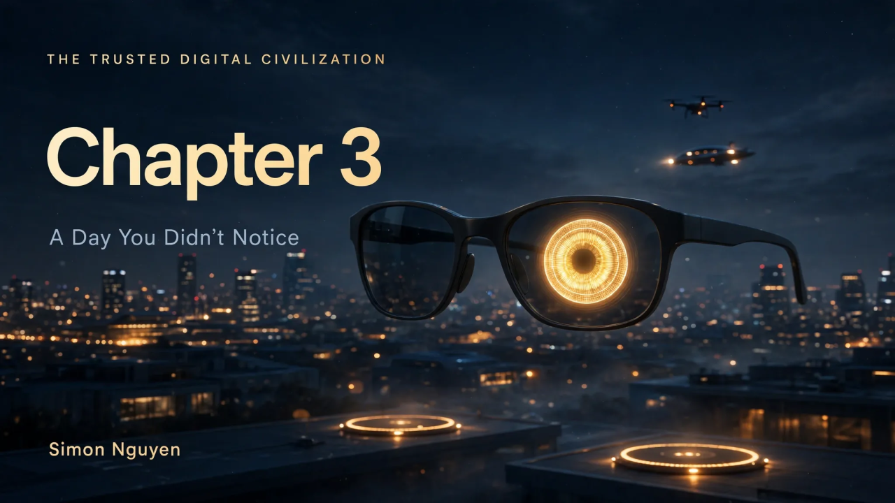
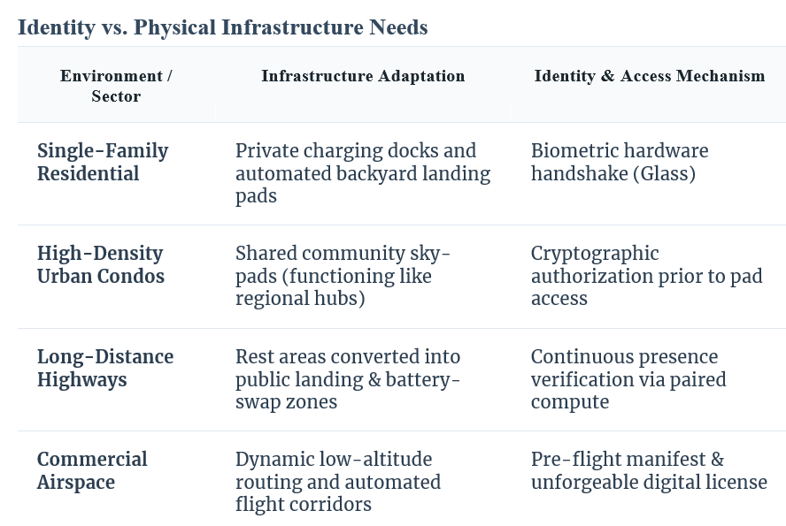

# The Trusted Digital Civilization Chapter 3: A Day You Didn't Notice

*By Simon Nguyen · Originally published on [LinkedIn](https://www.linkedin.com/pulse/trusted-digital-civilization-chapter-3-day-you-didnt-notice-nguyen-ajggc/)*

**Simon Nguyen** *Patent Pending — filed October 23, 2026*

You’ve seen it a hundred times, perhaps lived it yourself: a police officer pulls up behind you, walks to your window, and asks for your license and registration. You hand them over, they check your details against a database, and you are on your way. It is a quiet, familiar routine built on one fundamental assumption that we rarely question because it has always been true—*you can be stopped*. A car pulls over, an officer walks up, and verification happens face-to-face.

## The Paradigm Shift Above the Roads

The reality of flying cars is no longer a distant concept—it is actively taking shape, and with it comes an urgent need for an entirely new foundation of infrastructure and communication.

In the sky, you will need a modernized air-traffic control system capable of verifying exactly who you are before you ever leave the ground. By using secure hardware handshakes—like biometric iris verification embedded directly into smart glasses (Glass)—your identity becomes unforgeable, serving as your physical driver’s license. Before takeoff, you will submit your starting location and destination to receive your assigned routing and altitude.

The moment transportation leaves the ground, that traditional road-enforcement model breaks. You cannot flag down a drone at three hundred feet, nor can you pull a flying taxi over mid-route to check a license through the window. The traffic-stop model that has kept roads safe for a century simply stops working when a vehicle can fly.

And there is a second challenge underneath the first: even if you solve who is allowed to fly, you have not solved where they are allowed to land. If you own a large property with room for a private landing pad, space is an afterthought. If you live in a condo in a dense city, it is not.

Normal operations require shared departure pads, arrival pads, charging stations, and maintenance facilities. Furthermore, an aircraft denied clearance or forced to come down unexpectedly needs safe ground infrastructure that already exists—not something invented in the moment. Identity and infrastructure are two distinct problems, and any design that only solves the first while ignoring the second is incomplete.

Consequently, the question shifts: What replaces checking altogether when checking is no longer possible, and what has to physically exist on the ground before any of it works?

## Hardware-Anchored Trust

The answer for the sky is not a new kind of officer hiding behind a cloud. It is a new kind of certainty that does not wait to be asked.

Imagine sitting in a meeting where hallway noise bleeds through the door; before you even reach to adjust anything, your smart glasses quietly turn on hearing-assist mode. You didn't ask, but the system knows it is you wearing them through continuous, moment-to-moment verification. No app to open, no settings to hunt for—just a quiet certainty living in a secure chip on your face.

That same certainty makes things possible where an officer can never physically reach. Today, anyone can fly a drone over a neighborhood, and current identification systems can be easily spoofed. Although broadcast regulations require a digital license plate containing an ID, location, and altitude, security researchers have demonstrated that bad actors can override these transmissions with fake identities because the data is not anchored to a real person.

A trusted hardware identity closes that gap. If the drone operator on the ground wears the same verified presence as those smart glasses (Glass) paired with the pocket computing engine (Tiny Box), the drone can confirm its operator cryptographically before it is ever allowed to arm. Flight plans are checked beforehand, backed by an identity that cannot be faked by someone broadcasting from a laptop across the street. Nobody has to chase a rogue vehicle mid-flight because the system never let an unverified flight leave the ground.

## The Architecture of Quiet Certainty

Widen the lens to electric air taxis carrying people instead of packages, and the logic remains identical. The technical stakes are higher, but the foundational problems of pilot credentials and landing infrastructure remain the same.

None of this is science fiction: the broadcast systems exist, vulnerabilities are documented, and passenger aircraft certification is underway. What has been missing is the link between a claimed identity and an actual person—something worn that cannot be handed off or spoofed—paired with the ground infrastructure required to support it.

That is what a trusted digital civilization looks like in practice. It is not a world that watches your every move, but one that finally answers the one question a traffic stop could always ask and the sky never could, remaining honest about what must be built before it gets out of your way.
