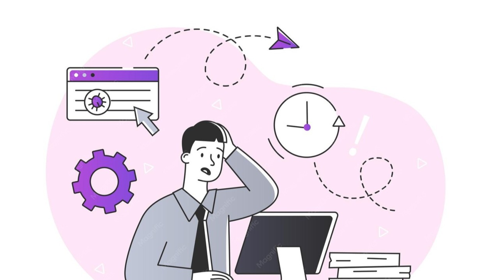

# When Technology Stops Feeling Human — Especially with Passwords

*By Simon Nguyen · Originally published on [LinkedIn](https://www.linkedin.com/pulse/when-technology-stops-feeling-human-especially-passwords-simon-nguyen-8eggc/)*

I work in technology, but even for me, something as simple as logging into an app has become a small daily struggle. Most of the time, I use my fingerprint to unlock my security master password app. It’s supposed to make things easier. But life isn’t perfect. Sometimes my hands are dirty. Sometimes I’m cooking. Sometimes I’m working outside. Sometimes I get a tiny cut or a scar on my finger. And suddenly the fingerprint doesn’t work.

So I’m forced to type the master password inside the security master password app — the one I rarely use — and hope I remember it correctly. Then the whole routine begins: open the app, scroll through a long list of logins, find the right one, copy it, paste it into the website… and then it doesn’t work.

For a moment I get frustrated. Then I realize the truth: **I forgot to update the password in my own security master password app. I’m fighting my own system.** And this is coming from someone who works in tech.

If it takes me this much effort, I can only imagine how overwhelming it must feel for people who don’t work with computers every day. Most of them avoid these apps completely. And storing passwords isn’t simple either. There’s no intelligence in these apps — you have to manually type the website name, the username, the password, and sometimes extra notes. When you do this 30+ times, your eyes blur, the list becomes a wall of text, and you end up confusing yourself. It’s easy to get dizzy just trying to find the right entry. And the design of these apps doesn’t help. Some of them don’t even have a proper search bar, or the search barely works. You’re forced to scroll through everything manually. When you have 30+ entries, the screen becomes a blur of tiny text and website names. Your eyes get tired, you lose your place, and the whole thing makes you dizzy. **It is a nightmare for me.**

Somewhere along the way, technology stopped being simple. It stopped being human. It started demanding too much from us — too many rules, too many steps, too many things to remember.

We don’t talk about it much, but the truth is simple: we’re juggling too many accounts, we’re creating passwords we instantly forget, we’re resetting the same logins over and over, we’re storing passwords in apps that also need passwords, and we’re wasting time fighting tools that were supposed to help us. All of this just to prove who we are.

One morning, after another failed login attempt, I sat back and asked myself a quiet question: **Why does something so basic feel so hard.** Why do I need dozens of passwords? Why do I need a separate app just to remember them? Why does a tiny cut on my hand break my entire flow? Why does logging in feel like a test I keep failing?

Maybe the problem isn’t us. Maybe the problem is that technology has become too complicated for normal life. And maybe — just maybe — there’s a better way for us to interact with the digital world.

A way that doesn’t fall apart when my hands are dirty. A way that doesn’t punish me for forgetting. A way that doesn’t make me scroll through 200 entries just to find one password. A way that feels natural, simple, and human.

I don’t have the full answer yet. But I know this: **Technology should adapt to people — not the other way around.** And I think it’s time we start talking about that.
